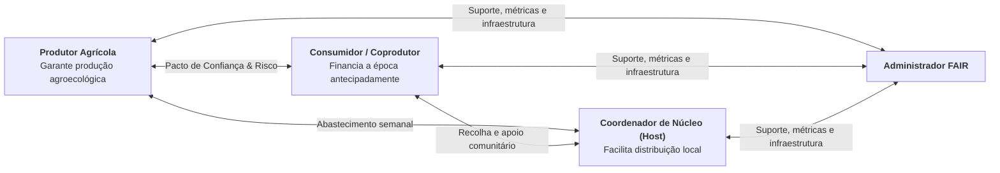
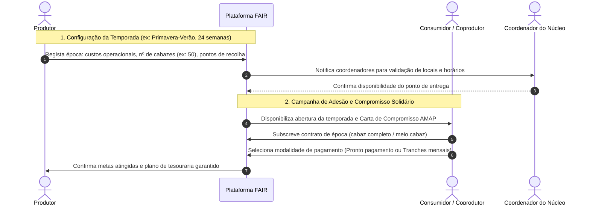
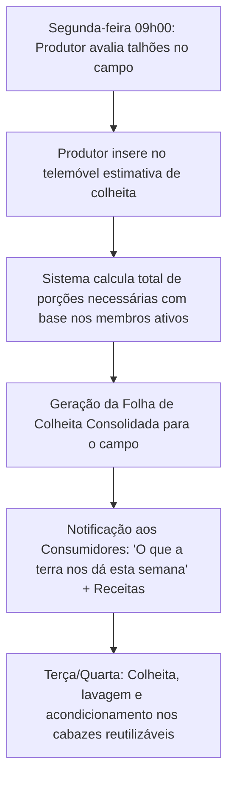
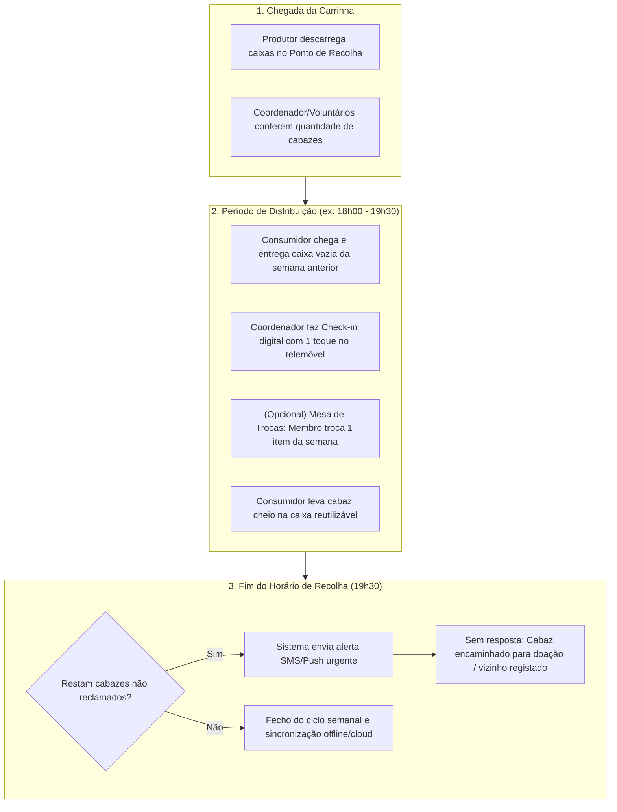
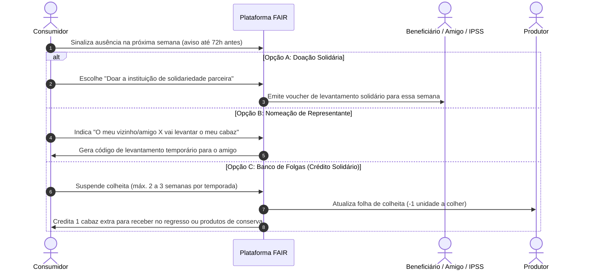
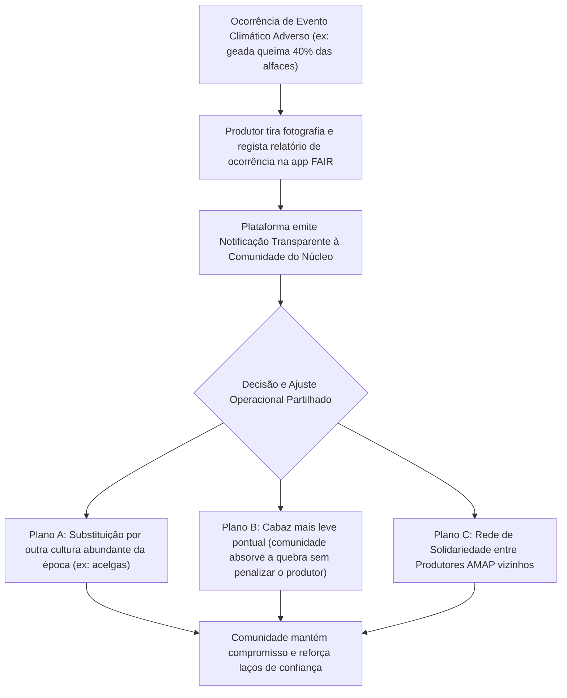
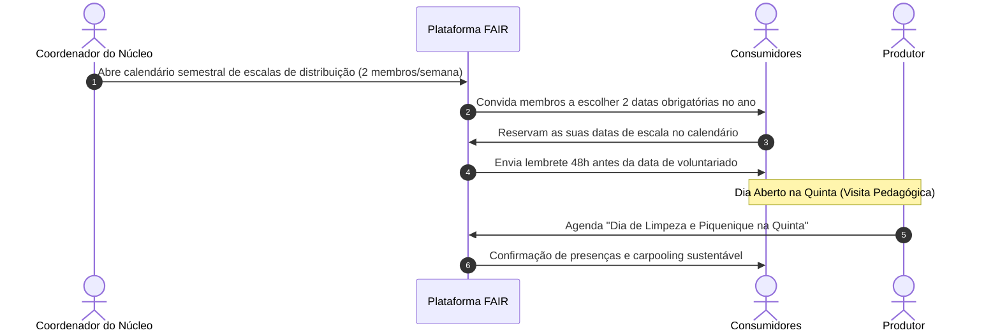

# Fase 2: Mapeamento de Stakeholders, Personas e Processos de Negócio

**Projeto:** FAIR Software Solutions — Plataforma para o Ecossistema AMAP/CSA  
**Módulo:** Engenharia de Requisitos (ENGREQ) — Super Stars (ISEP)  
**Âmbito:** Modelação de Utilizadores, Proposta de Valor e Fluxos Operacionais de Ponta a Ponta  

---

## 1. Mapeamento de Stakeholders e Value Proposition Canvas

No ecossistema AMAP/CSA, a relação comercial é substituída por uma **parceria de corresponsabilidade**. Para conceber uma solução de software eficaz, é indispensável analisar as tarefas fundamentais (*Customer Jobs*), as dores (*Pains*) e os ganhos esperados (*Gains*) de cada ator.



---

### 1.1. Matriz de Tarefas, Dores e Ganhos por Stakeholder

| Stakeholder | Tarefas Principais (*Customer Jobs*) | Dores Atuais (*Pains*) | Ganhos Almejados (*Gains*) |
| :--- | :--- | :--- | :--- |
| **Produtor / Camponês** | • Planear a época de cultivo<br>• Estimar e executar colheitas semanais<br>• Assegurar transporte até aos pontos de recolha<br>• Cobrar e conciliar pagamentos | • Perda de horas em tarefas administrativas e folhas de cálculo<br>• Incerteza climática e perdas não compensadas<br>• Membros que desistem a meio da época ou atrasam pagamentos<br>• Uso desconfortável de tecnologias complexas sob luz solar/lama | • Previsibilidade de receita e capital adiantado<br>• Desperdício zero no campo (venda prévia total)<br>• Foco a 100% no cultivo e regeneração do solo<br>• Relação de respeito e apreço com quem consome |
| **Consumidor / Coprodutor** | • Assegurar alimentação saudável e biológica à família<br>• Levantar o cabaz semanalmente no ponto e horário fixos<br>• Cozinhar produtos sazonais frescos<br>• Pagar as tranches acordadas | • Receber produtos desconhecidos e deixá-los estragar<br>• Falta de flexibilidade nas semanas de férias ou deslocações<br>• Falta de métodos de pagamento modernos (ex: MB Way)<br>• Sentimento de culpa ao não conseguir cumprir o compromisso | • Alimentos frescos colhidos no próprio dia, sem químicos<br>• Preço justo e apoio direto a uma família de agricultores<br>• Educação alimentar dos filhos e consciência ecológica<br>• Facilidade em gerir ausências ou trocar legumes indesejados |
| **Coordenador do Núcleo (Host / Voluntário)** | • Disponibilizar ou articular o local de recolha (garagem, associação, escola)<br>• Supervisionar a entrega dos cabazes semanais<br>• Gerir escalas de voluntários e presenças<br>• Responder a dúvidas de novos membros | • Carga mental e esforço voluntário desmedido<br>• Membros que não aparecem para levantar o cabaz<br>• Listas de papel desatualizadas e rasuradas<br>• Desistência de voluntários por exaustão | • Ferramenta simples no telemóvel para check-in com 1 toque<br>• Escalas de apoio preenchidas automaticamente pelos membros<br>• Coesão comunitária e dinamização do bairro/associação<br>• Processo de distribuição rápido (< 1 a 2 horas) |
| **Administrador FAIR / Gestor de Rede** | • Manter a plataforma estável e segura<br>• Garantir integridade de dados e conformidade legal (RGPD/AT)<br>• Monitorizar métricas agregadas de impacto ODS | • Dificuldade em recolher dados fiáveis de explorações remotas<br>• Resistência cultural a tecnologias proprietárias fechadas | • Métricas comprovadas de redução de CO2 e impacto local<br>• Escalabilidade sustentável da rede de núcleos |

---

## 2. Personas Detalhadas

---

### Persona 1: O Produtor Agroecológico

```mermaid
card
title: "Tiago Silva — O Produtor Familiar"
content:
"Idade: 42 anos
Localização: Penafiel / Entre Douro e Minho
Ocupação: Agricultor Agroecológico em Exploração Familiar (3,5 hectares)
Literacia Digital: Média-Baixa (utiliza smartphone para WhatsApp e chamadas)
Motivação: Preservar a terra sem pesticidas e ter rendimento digno"
```

* **Perfil e Contexto:** Tiago herdou terrenos da família e converteu a quinta para práticas biológicas há 8 anos. Trabalha com a companheira e um empregado sazonal. Vende para dois núcleos AMAP (Porto e Matosinhos) e tem 65 cabazes semanais subscritos.
* **Citação Típica:** *"Eu sou agricultor, não sou contabilista de escritório. Ao fim de 10 horas de trabalho no campo a dobrar as costas, ainda ter de abrir o computador para ver quem pagou por transferência e quem vai de férias na semana seguinte tira-me o sono."*
* **Objetivos:**
  * Ter a lista exata do que tem de colher em cada terça-feira de manhã antes de carregar a carrinha.
  * Ter a certeza de que as mensalidades caem na conta a tempo sem ter de andar a fazer cobranças constrangedoras aos membros.
  * Comunicar facilmente quando uma praga ou chuva intensa estraga uma cultura, sem receio de represálias.
* **Frustrações Tecnológicas:**
  * Odeia aplicações com menus escondidos, ecrãs com texto minúsculo e processos de validação de 10 passos.
  * Muitas vezes está no barracão agrícola sem rede 4G e as páginas web bloqueiam sem guardar os dados.

---

### Persona 2: A Consumidora / Coprodutora Urbana

```mermaid
card
title: "Mariana Costa — A Consumidora Consciente"
content:
"Idade: 34 anos
Localização: Bonfim, Porto
Ocupação: Designer de Comunicação e mãe de duas crianças (3 e 6 anos)
Literacia Digital: Muito Elevada (utilizadora diária de apps móveis e MB Way)
Motivação: Saúde dos filhos, produtos locais e redução da pegada de carbono"
```

* **Perfil e Contexto:** Mariana aderiu ao núcleo da AMAP há um ano. Adora saber de onde vem a comida das crianças e confia inteiramente no produtor. No entanto, a vida profissional intensa e as viagens regulares criam momentos de atrito logístico.
* **Citação Típica:** *"Quero apoiar o Tiago e pagar o que for justo, mas preciso de flexibilidade. Se vou estar fora em trabalho numa quinta-feira, preciso de poder doar o meu cabaz ou avisar com 2 cliques na app sem criar confusão ao produtor."*
* **Objetivos:**
  * Saber com 24 a 48 horas de antecedência o que virá no cabaz para planear as refeições familiares da semana.
  * Ter sugestões ou receitas rápidas para legumes sazonais menos óbvios (ex: funcho, cherovia).
  * Pagamento sem fricção (preferencialmente débito automático ou autorização MB Way).
* **Frustrações:**
  * Já lhe aconteceu esquecer-se de avisar com dias de antecedência que ia de férias e o cabaz acabou por apodrecer no ponto de recolha.
  * Sente pena quando vêm quantidades excessivas de um legume que as crianças não comem e gostaria de poder trocá-lo por outro no local.

---

### Persona 3: O Coordenador de Núcleo (Host Voluntário)

```mermaid
card
title: "Carlos Henriques — O Facilitador Comunitário"
content:
"Idade: 58 anos
Localização: Vila Nova de Gaia
Ocupação: Professor do Ensino Secundário e ativista associativo
Literacia Digital: Média (confortável com email, Office e navegação web)
Motivação: Fortalecer o tecido comunitário de bairro e a economia local"
```

* **Perfil e Contexto:** Carlos disponibilizou o pátio da associação cultural onde é dirigente para acolher a entrega semanal dos cabazes (todas as quintas-feiras entre as 18h00 e as 19h30). Atua como intermediário benevolente entre 40 famílias e o agricultor.
* **Citação Típica:** *"Eu faço isto por carolice e amor à causa, mas fico furioso quando chega quinta-feira às 19h45, tenho de fechar a sede e ainda estão três cabazes à espera de pessoas que não avisaram nem atenderam o telefone."*
* **Objetivos:**
  * Ter um ecrã no telemóvel onde vê a lista das 40 pessoas e marca com um toque quem já levantou o cabaz (*Check-in*).
  * Ter as escalas de acolhimento asseguradas pelos próprios membros de forma rotativa, sem ter de implorar por voluntários no WhatsApp.
  * Despachar os cabazes não reclamados às 19h30 através de um protocolo claro (ex: doação a família carenciada do bairro).

---

## 3. Modelação Completa dos Processos de Negócio (Workflows Operacionais)

Apresentam-se os fluxos operacionais detalhados, desenhados para cobrir todas as fases da dinâmica AMAP/CSA.

---

### Processo 1: Abertura e Adesão à Temporada / Campanha Agrícola (Season Commitment)

Ao contrário do comércio eletrónico pontual, a época começa com um compromisso financeiro e orçamental mútuo.



#### Passos Operacionais e Regras de Negócio:
1. **Orçamento e Dimensionamento:** O produtor calcula o montante necessário para cobrir os seus custos de produção anuais/semestrais (sementes, água, salários, amortizações) e divide pelo número de membros previstos.
2. **Subscrição do Compromisso:** O consumidor aceita a Carta de Princípios (aceitação de variações na colheita por motivos climáticos).
3. **Modalidade Financeira:**
   - *Opção A (Integral):* Pagamento a pronto com desconto de taxa.
   - *Opção B (Tranches programadas):* Cobrança automática mensal (via SEPA Direct Debit ou agendamento MB Way), garantindo que o agricultor não sofre quebra de fluxo de caixa.

---

### Processo 2: Planeamento Semanal de Colheita e Composição do Cabaz



#### Passos Operacionais e Regras de Negócio:
1. **Registo de Disponibilidade:** O produtor preenche um formulário simplificado (*"Esta semana teremos: 1kg tomate, 500g feijão-verde, 1 alface, 1 molho cenouras, ervas aromáticas"*).
2. **Cálculo de Necessidades Reais:** O software subtrai automaticamente os membros que sinalizaram ausência/férias para essa semana específica, evitando colheita desnecessária.
3. **Folha de Trabalho de Campo:** É gerada uma ordem de colheita agregada (ex: *"Colher 42 kg de tomate e 42 alfaces"*).
4. **Comunicação Pedagógica:** O membro recebe no telemóvel o conteúdo previsto do cabaz acompanhado de 1 ou 2 receitas simples sugeridas para os produtos mais raros.

---

### Processo 3: Distribuição e Operação no Ponto de Recolha (Distribution Hub)



#### Regras de Negócio do Ponto de Recolha:
* **Check-in Rápido:** A interface do coordenador apresenta uma lista alfabética pesquisável com botão de alternância (*Toggle*) verde/cinzento. Funciona 100% offline se o pátio da associação não tiver sinal Wi-Fi/4G.
* **Circuito de Caixas Reutilizáveis:** O sistema monitoriza a rotação de caixas (o membro deve trazer a caixa limpa da semana passada para levantar a deste dia).
* **Mesa de Partilha / Trocas (*Swap Table*):** Regra física e digital onde os membros podem depositar um vegetal que não consomem e retirar outro deixado por outro colega, sem alterar as contas do agricultor.

---

### Processo 4: Gestão de Ausências, Férias e Flexibilidade Solidária

O maior ponto de fricção que causa desistências na CSA é resolvido com um fluxo transparente e cooperativo.



#### Regras de Negócio da Política de Ausências:
1. **Prazo de Antecedência:** O aviso de férias deve ser registado até à data/hora de fecho de ciclo (*Cut-off Time*, ex: Domingo às 23h59 para colheitas de Terça).
2. **Limite de Suspensões:** Para proteger o agricultor, o número de créditos por suspensão é limitado por contrato de temporada (ex: máximo 3 semanas por época de 6 meses).
3. **Respeito pelo Financiamento:** O agricultor já comprou as sementes; por isso, a ausência do membro não dá direito a reembolso monetário, mas sim a doação, indicação de terceiros ou compensação em produtos não perecíveis (azeite, compotas, mel) no final da safra.

---

### Processo 5: Gestão de Imprevistos Climáticos e Partilha de Risco (Risk Sharing)

Este processo materializa a essência ética da AMAP/CSA face aos acidentes naturais (seca, granizo, pragas).



#### Regras de Negócio:
* **Comunicação Imediata:** Elimina a desconfiança através de imagens e explicações técnicas do camponês.
* **Salvaguarda do Agricultor:** A plataforma não permite o cancelamento punitivo unilateral de contratos devido a eventos naturais comprovados pela rede.

---

### Processo 6: Dinamização Comunitária, Turnos de Apoio e Prestação de Contas



#### Benefícios Diretos deste Processo:
* **Desoneração do Coordenador:** A responsabilidade de estar no ponto de entrega é rotativa e partilhada por todas as famílias.
* **Transparência Contabilística:** No final de cada época, o sistema gera automaticamente um relatório de prestação de contas: volume de quilos distribuídos, taxa de presenças e poupança estimada em emissões de gases com efeito de estufa.
