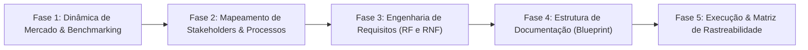

# FAIR Software Solutions — Market Research & Dynamics Plan: AMAP / CSA

**Contexto:** Soluções de software para distribuição e venda alimentar sustentável (Agenda 2030 / ODS)  
**Projeto:** Especificação de Requisitos de Software para o ecossistema AMAP (Associação para a Manutenção da Agricultura de Proximidade) e CSA (*Community Supported Agriculture*)  
**Mercado Alvo:** Portugal (Primário), Espanha, França, Europa e Américas  
**Equipa:** ENGREQ Super Stars — ISEP  

---

## 1. Catálogo de Fontes de Investigação de Mercado (Websites, Artigos Científicos, Documentos e Plataformas)

Para fundamentar a análise de mercado e a dinâmica do setor AMAP/CSA, foi estruturado um conjunto abrangente de fontes verídicas, académicas, institucionais e tecnológicas, divididas por âmbito geográfico e temático.

---

### 1.1. Portugal (Mercado Alvo Primário)

Embora o ecossistema de CSA formal seja emergente em Portugal, existem redes consolidadas de circuitos curtos, agroecologia e cooperativas que servem de base direta para o estudo.

#### A. Redes e Organizações
1. **Portal AMAP Portugal (Moving Cause)**
   - **URL:** [https://amap.movingcause.org/](https://amap.movingcause.org/)
   - **Relevância:** Ponto central de articulação das AMAP em Portugal; contém a Carta de Princípios, o mapeamento de produtores aderentes e pontos de distribuição ativos (AMAP Porto, Gaia, Guimarães, Matosinhos, Beja, Maravilha, etc.).
2. **Rede REGENERAR**
   - **URL:** [https://movingcause.org/regenerar/](https://movingcause.org/regenerar/) / [Campanha REGENERAR PPL](https://ppl.pt/regenerar)
   - **Relevância:** Rede formal de núcleos de AMAP/CSA do Norte ao Sul de Portugal e ligação à agroecologia solidária.
3. **PROVE — Promover para Vender**
   - **URL:** [https://www.prove.com.pt/](https://www.prove.com.pt/)
   - **Relevância:** A maior rede de circuitos curtos agroalimentares e cabazes locais de pequenos produtores em Portugal, apoiada por Grupos de Ação Local (GAL) e Municípios. Estudo de caso essencial sobre logística de cabazes, periodicidade e retenção de consumidores.
4. **Herdade do Freixo do Meio / CSA "Partilhar as Colheitas"**
   - **URL:** [https://freixodomeio.pt/](https://freixodomeio.pt/)
   - **Relevância:** Caso de estudo de referência de agricultura biodinâmica e CSA em larga escala no Alentejo (Montemor-o-Novo e rede de distribuição em Lisboa), com modelo cooperativo de partilha de risco.
5. **Rede Rural Nacional (Ministério da Agricultura e Alimentação)**
   - **URL:** [https://www.rederural.gov.pt/](https://www.rederural.gov.pt/)
   - **Relevância:** Manuais de boas práticas em Circuitos Curtos Agroalimentares (CCA), estatísticas da pequena agricultura familiar e enquadramento das medidas do PEPAC / PDR 2020.
6. **ACTA — Associação para o Desenvolvimento da Agroecologia e Agricultura Familiar**
   - **Relevância:** Dados empíricos sobre agricultura camponesa e escoamento em proximidade.

#### B. Literatura Académica e Teses de Doutoramento/Mestrado (Portugal)
1. **Teixeira, F. (2014)** — *Circuitos Curtos Agroalimentares em Portugal: estudo de casos*. Dissertação de Mestrado, ISCTE-IUL.
   - [Repositório ISCTE](https://repositorio.iscte-iul.pt/handle/10071/9205)
   - *Foco:* Motivações dos produtores e consumidores em Portugal, canais de escoamento e barreiras operacionais.
2. **Polita, F. S. (2021)** — *Portugal: estudos sobre inovação agroecológica e cadeias curtas agroalimentares*. Tese de Doutoramento.
   - [RCAAP — Repositório Científico de Acesso Aberto de Portugal](https://www.rcaap.pt/)
   - *Foco:* Arranjos colaborativos entre consumidores e produtores na transição agroecológica portuguesa.
3. **Soares, R. (2022)** — *Perspectivas para a cidadania alimentar no contexto da Agricultura Apoiada pela Comunidade*. Tese de Doutoramento, Universidade de Trás-os-Montes e Alto Douro (UTAD).
   - *Foco:* O papel da CSA em Portugal na transformação de hábitos alimentares e governação partilhada.
4. **Figueiredo, E. et al. (Universidade de Aveiro)** — Publicações sobre "Representações Sociais do Rural", consumo ético e cadeias de valor alimentar de proximidade.
5. **DGT / Projeto reLOCALiza** — Estudos de territorialização das redes alimentares e consumo institucional público em Portugal.

---

### 1.2. França (Referência Europeia no Modelo AMAP)

França é o país com maior maturidade no modelo AMAP (*Association pour le maintien d'une agriculture paysanne*), com mais de 2.000 grupos em operação.

1. **MIRAMAP (Mouvement Inter-Régional des AMAP)**
   - **URL:** [http://miramap.org/](http://miramap.org/) / [http://mouvement-amap.org/](http://mouvement-amap.org/)
   - **Relevância:** Organização cúpula em França. Responsável pela **Charte des AMAP (2014)**, a matriz fundacional que define os 18 princípios fundamentais das AMAP (solidariedade, compromisso anual, transparência de custos, produção agroecológica sem químicos).
2. **Réseau AMAP Île-de-France**
   - **URL:** [https://amap-idf.org/](https://amap-idf.org/)
   - **Relevância:** Guias detalhados de funcionamento interno, modelos de contratos jurídicos e financeiros entre consumidor e camponês, ferramentas de facilitação e relatórios anuais de atividade.
3. **INRAE (Institut National de Recherche pour l'Agriculture, l'Alimentation et l'Environnement)**
   - **URL:** [https://www.inrae.fr/](https://www.inrae.fr/)
   - **Relevância:** Centenas de estudos peer-reviewed sobre o impacto socioeconómico das AMAP, rentabilidade das explorações agrícolas familiares, retenção de cooperantes e fixação de preços justos.
4. **Plataformas de Software Francesas Dedicadas:**
   - **AmapJ:** [http://amapj.fr/](http://amapj.fr/) — Software livre/dedicado concebido especificamente para as necessidades administrativas das AMAP (gestão de contratos sazonais, pagamentos fracionados em cheques/SEPA, gestão de ausências e escalas de presença na distribuição).
   - **Cagette.net:** [https://www.cagette.net/](https://www.cagette.net/) — Plataforma SaaS e colaborativa de comércio direto amplamente utilizada por grupos de consumo e AMAPs em França e Bélgica.

---

### 1.3. Espanha (Grupos de Consumo e Proximidade Ibérica)

Espanha partilha similitudes climáticas, fiscais e culturais com Portugal, operando frequentemente sob a designação de *Grupos Autogestionados de Consumo (GAKs)* e *Red CSA*.

1. **Red de Agricultura Apoyada por la Comunidad (Red CSA Espanha)**
   - **URL:** [https://ecologistasenaccion.org/](https://www.ecologistasenaccion.org/) / Artigos de Soberanía Alimentaria
   - **Relevância:** Guias práticos para criação de grupos de consumo sustentáveis e análise crítica das plataformas digitais de intermediação alimentar.
2. **Revista Soberanía Alimentaria, Biodiversidad y Culturas**
   - **URL:** [https://soberaniaalimentaria.info/](https://soberaniaalimentaria.info/)
   - **Relevância:** Documentação de casos práticos (Andaluzia, Catalunha, Madrid, País Basco) de canais curtos de comercialização (CCC) e economia social.
3. **SEAE (Sociedad Española de Agricultura Ecológica y Agroecología)**
   - **URL:** [https://agroecologia.net/](https://agroecologia.net/)
   - **Relevância:** Dados agronómicos, normativos e de certificação participativa (SPG — Sistemas Participativos de Garantia).
4. **Katuma / Open Food Network Spain**
   - **URL:** [https://redalimentacionabierta.org/](https://redalimentacionabierta.org/) / [https://katuma.org/](https://katuma.org/)
   - **Relevância:** Aplicação web para grupos de consumo e cooperativas agroecológicas gerirem pedidos agregados e distribuição.

---

### 1.4. Europa e Âmbito Global (URGENCI & Políticas da UE)

1. **URGENCI — The International Network for Community Supported Agriculture**
   - **URL:** [https://urgenci.net/](https://urgenci.net/)
   - **Documentos Chave:**
     - *Overview of Community Supported Agriculture in Europe (2016 Census Report):* Estudo de referência que mapeou 2.783 iniciativas CSA alimentando ~475.000 consumidores em 22 países europeus.
     - *European Handbook on CSA (CSA4Europe Project):* Manual de boas práticas de gestão comunitária e pedagógica.
     - *Training modules for CSA Farmers and Consumers:* Guias para gestão financeira e orçamentação partilhada.
2. **EIP-AGRI (European Innovation Partnership for Agricultural Productivity and Sustainability)**
   - **URL:** [https://ec.europa.eu/eip/agriculture/](https://ec.europa.eu/eip/agriculture/)
   - **Relevância:** *Focus Group on Short Food Supply Chains (Final Report)* — análise exaustiva da Comissão Europeia sobre logística colaborativa, barreiras de entrada tecnológica e preferências dos consumidores europeus.
3. **OpenOlitor (Suíça e Alemanha)**
   - **URL:** [https://openolitor.org/](https://openolitor.org/) | [GitHub Repository](https://github.com/openolitor)
   - **Relevância:** Software open-source (licença AGPL v3) especificamente desenhado para CSA. Gere planeamento de sementeiras, subscrições de cabazes, férias dos associados, escalas de trabalho voluntário na quinta e faturação.
4. **Open Food Network (OFN Global)**
   - **URL:** [https://openfoodnetwork.org/](https://openfoodnetwork.org/) | [OFN GitHub](https://github.com/openfoodfoundation)
   - **Relevância:** A maior infraestrutura digital open-source do mundo para sistemas alimentares locais, cooperativas e food hubs.

---

### 1.5. Américas (Maturidade de Mercado & Modelos SaaS)

A América do Norte possui o ecossistema comercialmente mais avançado em termos de ferramentas de software especializadas para CSA, oferecendo valiosos *benchmarks* de requisitos de usabilidade e retenção.

1. **CSA Innovation Network (EUA)**
   - **URL:** [https://www.csainnovationnetwork.org/](https://www.csainnovationnetwork.org/)
   - **Relevância:** Rede nacional de consultores agrícolas, agricultores e investigadores dos EUA. Publica relatórios de benchmarking sobre taxas de retenção de membros (tipicamente 45-50% sem personalização, subindo para 70%+ com personalização de cabaz), pricing e estratégias de marketing digital.
2. **USDA Agricultural Marketing Service (AMS)**
   - **URL:** [https://www.ams.usda.gov/](https://www.ams.usda.gov/)
   - **Relevância:** Guias oficiais do Departamento de Agricultura dos EUA sobre modelos de negócio CSA, centros de agregação (*Food Hubs*) e venda direta ao consumidor.
3. **LocalHarvest**
   - **URL:** [https://www.localharvest.org/](https://www.localharvest.org/)
   - **Relevância:** Diretório público pioneiro de mais de 40.000 quintas locais e pontos de recolha nos EUA.
4. **Principais Plataformas Comerciais de Software (Benchmark Tecnológico):**
   - **Harvie:** [https://www.harvie.farm/](https://www.harvie.farm/) — Plataforma que revolucionou o modelo CSA nos EUA ao introduzir *cabazes personalizáveis* através de algoritmos de preferência sem sobrecarregar a logística do agricultor.
   - **Farmigo:** [https://www.farmigo.com/](https://www.farmigo.com/) — O software pioneiro de gestão de assinaturas, pontos de recolha (*drop sites*) e rota logística para CSAs.
   - **Barn2Door:** [https://www.barn2door.com/](https://www.barn2door.com/) — Solução SaaS com foco em e-commerce omnicanal para agricultores independentes (subscrições, entregas privadas, integração POS).
   - **Local Line:** [https://localline.ca/](https://localline.ca/) — Plataforma de e-commerce e gestão logística focada em quintas, cooperativas e food hubs.

---

### 1.6. Alinhamento com a Agenda 2030 e Objetivos de Desenvolvimento Sustentável (ODS)

A solução da FAIR Software Solutions insere-se diretamente no quadro das Nações Unidas:

- **ODS 2 — Fome Zero e Agricultura Sustentável:**
  - *Meta 2.3:* Duplicar a produtividade agrícola e os rendimentos dos pequenos produtores de alimentos através do acesso seguro a mercados justos.
  - *Meta 2.4:* Garantir sistemas sustentáveis de produção de alimentos e aplicar práticas agrícolas resilientes (agroecologia).
- **ODS 11 — Cidades e Comunidades Sustentáveis:**
  - *Meta 11.a:* Fortalecer a ligação económica, social e ambiental entre zonas urbanas, periurbanas e rurais através de circuitos de proximidade.
- **ODS 12 — Produção e Consumo Sustentáveis:**
  - *Meta 12.3:* Reduzir pela metade o desperdício alimentar per capita mundial e reduzir as perdas alimentares ao longo das cadeias de produção e abastecimento (o modelo de colheita sob contrato prévio elimina o excedente não colhido).
  - *Meta 12.8:* Garantir informação e consciencialização para estilos de vida sustentáveis em harmonia com a natureza.
- **ODS 13 — Ação Climática:**
  - Redução drástica dos "quilómetros alimentares" (*food miles*), menor consumo de combustível fóssil e eliminação de embalagens descartáveis/plásticos nos cabazes reutilizáveis.

---

## 2. Plano Estruturado para Documentação e Tratamento dos Dados

Para que a equipa do projeto (ENGREQ Super Stars) possa transformar estes dados de pesquisa de mercado numa **Especificação de Requisitos de Software (SRS)** sólida e rastreável, apresenta-se o plano de execução metodológico em 5 fases.



---

### Fase 1: Análise Estratégica e Dinâmica de Mercado

1. **Análise PESTEL Contextualizada (Portugal & Península Ibérica):**
   - **Político/Legal:** Política Agrícola Comum (PAC/PEPAC), incentivos aos circuitos curtos, faturação eletrónica obrigatória (AT/SAF-T em Portugal), Regulamento Geral sobre a Proteção de Dados (RGPD).
   - **Económico:** Inflação alimentar, esmagamento das margens dos produtores pela grande distribuição, poder de compra dos consumidores e sensibilidade ao preço vs valorização da saúde.
   - **Social:** Crescimento da procura por produtos bio/locais, estilo de vida urbano com pouco tempo para cozinhar, vontade de apoiar a economia local e reconectar com o campo.
   - **Tecnológico:** Dispersão em folhas de Excel, trocas de emails e mensagens de WhatsApp; necessidade de soluções mobile-first com UX simplificada para todas as idades.
   - **Ecológico:** Escassez hídrica na Península Ibérica, urgência na regeneração do solo, redução da pegada de carbono e eliminação do plástico.

2. **As 5 Forças de Porter Aplicadas ao Software AMAP/CSA:**
   - *Rivalidade entre Concorrentes:* Baixa a moderada entre ferramentas dedicadas abertas (AmapJ, Open Food Network), mas alta concorrência indireta com ferramentas genéricas (Excel, Google Forms, WhatsApp).
   - *Ameaça de Novos Entrantes:* Plataformas genéricas de comércio eletrónico (Shopify, WooCommerce) que tentam vender modelos de subscrição sem compreender a lógica de partilha de risco agrícola.
   - *Poder de Negociação dos Compradores (Produtores e Consumidores):* Alto; o agricultor familiar tem margens reduzidas e resiste a comissões percentuais elevadas sobre as vendas.
   - *Poder de Negociação dos Fornecedores:* Baixo (infraestrutura cloud e gateways de pagamento commodity).
   - *Ameaça de Produtos Substitutos:* Cabazes biológicos de retalho tradicional (Continente Bio, Auchan) ou startups de "resgate" alimentar (Good After, Too Good To Go, Equal Food), que comercializam sem o pacto solidário da CSA.

3. **Matriz de Benchmarking Competitivo de Software:**
   Criar uma tabela comparativa avaliando:
   - *AmapJ, Cagette.net, OpenOlitor, Open Food Network, Harvie, Barn2Door e PROVE*.
   - *Critérios de avaliação:* Modelo de negócio (Open source vs SaaS com comissão), Suporte ao compromisso de safra/temporada, Gestão de ausências/férias, Personalização de cabazes, Pagamentos integrados (MB Way / Débito Direto SEPA), Gestão de turnos/voluntários e Usabilidade móvel.

---

### Fase 2: Mapeamento de Stakeholders, Personas e Processos AMAP/CSA

A distinção crítica de uma AMAP/CSA face a um e-commerce comum é o **compromisso recíproco e a partilha do risco** (não é uma simples compra por impulso, mas sim um contrato de época).

1. **Identificação e Caracterização das Personas Centrais:**
   - **Produtor/Camponês:** Foco na lavoura; tem aversão a burocracia digital complexa; opera muitas vezes no campo com telemóvel e conectividade instável; necessita de saber com antecedência quantas unidades colher.
   - **Consumidor/Coprodutor ("Eater"):** Urbano/periurbano; valoriza saúde, ecologia e transparência; tem receio de receber legumes que não sabe cozinhar ou de perder cabazes durante as semanas de férias.
   - **Coordenador do Núcleo AMAP / Anfitrião do Ponto de Recolha (Host):** Voluntário; faz a ponte logística entre a quinta e os consumidores locais; gere a lista de entregas, os cabazes não levantados e as escalas comunitárias.
   - **Administrador do Sistema FAIR:** Supervisiona a integridade da plataforma, dados agregados de impacto ODS e suporte técnico.

2. **Mapeamento de Processos-Chave (BPMN / Fluxogramas):**
   - **Processo 1: Abertura e Adesão à Temporada (Season Launch):**
     - O produtor orçamenta o custo da época e define o número de partilhas disponíveis.
     - O consumidor subscreve o contrato para a época (ex: 6 meses) com opção de pagamento integral adiantado ou mensalidades programadas.
   - **Processo 2: Planeamento Semanal e Colheita:**
     - O produtor estima os alimentos prontos a colher e define a composição base do cabaz semanal.
     - (Opcional/Híbrido): Mecanismo de troca (*Swap Box* ou preferências prévias) para evitar desperdício alimentar.
   - **Processo 3: Distribuição e Recolha no Ponto de Entrega (Distribution Day):**
     - Notificação aos membros sobre a entrega.
     - Check-in de recolha no local (digital ou lista offline sincronizada).
     - Escala de voluntários para ajudar na receção e montagem.
   - **Processo 4: Gestão de Ausências e Férias:**
     - O consumidor sinaliza com dias de antecedência as semanas em que estará ausente; o sistema permite doar o cabaz a uma instituição de solidariedade, indicar um amigo para recolher ou creditar um cabaz duplo noutra semana.
   - **Processo 5: Gestão de Quebras e Partilha de Risco:**
     - Em caso de quebra de colheita por intempérie/geada, o sistema comunica de forma transparente à comunidade, recalculando o cabaz sem penalizar unilateralmente o agricultor.

---

### Fase 3: Transição para Engenharia de Requisitos (ENGREQ)

Transformar os *insights* de mercado em requisitos formais com rastreabilidade:

1. **Requisitos Funcionais (RF) estruturados por Módulos:**
   - **RF01 — Gestão de Perfis e Explorações Agrícolas:** Registo de práticas agroecológicas, localização da quinta e pontos de recolha associados.
   - **RF02 — Gestão de Contratos de Safra e Partilhas (Shares):** Modelação de épocas agrícolas, cabazes inteiros e meios cabazes, termos de compromisso mútuo.
   - **RF03 — Faturação e Pagamentos Solidários:** Integração com métodos locais (MB Way, Débito Direto SEPA, transferência bancária verificada e pagamentos em tranches sem taxa predatória).
   - **RF04 — Gestão Dinâmica de Cabazes e Ausências:** Calendário de entregas com suspensão temporária programada e sistema de trocas simples.
   - **RF05 — Terminal de Ponto de Recolha (Hub Manager):** Interface minimalista para marcação rápida de cabazes levantados na distribuição semanal.
   - **RF06 — Comunicação e Comunidade:** Publicação de novidades da quinta, cadernos de receitas para vegetais sazonais e agendamento de dias abertos/trabalhos na quinta.
   - **RF07 — Painel de Impacto ODS:** Cálculo automático de indicadores sustentáveis (kg de alimentos biológicos consumidos, km alimentares poupados, emissões de CO2 evitadas e rendimento líquido garantido ao camponês).

2. **Requisitos Não Funcionais (RNF):**
   - **RNF01 — Usabilidade & Acessibilidade:** Interface altamente intuitiva, botões grandes e legíveis para utilização no campo sob luz solar forte ou em tablets nos pontos de entrega (Diretrizes WCAG 2.1 nível AA).
   - **RNF02 — Conetividade e Resiliência (Offline-first):** Capacidade de o produtor e o coordenador do núcleo consultarem e marcarem presenças/colheitas mesmo em zonas rurais sem cobertura de rede 3G/4G/5G, com sincronização automática logo que a ligação seja restabelecida.
   - **RNF03 — Segurança e Conformidade Jurídica:** Plena conformidade com o RGPD (dados pessoais protegidos, sem monetização de dados de hábitos de consumo) e emissão de documentos fiscais conforme as normas da Autoridade Tributária portuguesa (SAF-T).
   - **RNF04 — Eficiência e Desempenho:** Arquitetura leve com baixo consumo de dados móveis, tempo de carregamento < 2 segundos em ligações móveis modestas.
   - **RNF05 — Interoperabilidade:** Formatos de exportação padronizados (CSV, JSON, APIs REST) compatíveis com normas de dados de sistemas alimentares abertos (ex: Data Food Consortium).

---

### Fase 4: Estrutura Recomendada para o Dossier de Documentação do Projeto

Para garantir organização máxima no repositório de trabalho da equipa, sugere-se a seguinte estrutura de pastas e ficheiros:

```text
Trabalho/
└── Market Research/
    ├── market-research-prompt.md            # Requisitos e contexto inicial do projeto
    ├── market-research-study-and-plan.md     # Este documento (fontes consolidadas e plano)
    ├── 01_Fontes_e_Leituras/
    │   ├── fichamento-urgenci-census.md     # Resumo e dados do censo europeu URGENCI
    │   ├── fichamento-charte-miramap.md     # Análise da Carta Francesa das AMAP
    │   ├── notas-estudos-portugal.md        # Síntese das teses do ISCTE, UTAD e PROVE
    │   └── fontes-ods-agenda2030.md         # Mapeamento detalhado das metas ODS 2 e 12
    ├── 02_Analise_Mercado_Dinamica/
    │   ├── analise-pestel.md                # Fatores PESTEL detalhados para Portugal e Espanha
    │   ├── forcas-porter.md                 # Análise de concorrência e barreiras
    │   ├── benchmarking-software.md         # Tabela comparativa (Harvie, AmapJ, Open Food Network...)
    │   └── estimativa-tam-sam-som.md        # Dimensionamento do mercado potencial
    ├── 03_Stakeholders_e_Processos/
    │   ├── personas.md                      # Perfis do Produtor, Consumidor e Coordenador
    │   ├── user-journeys.md                 # Jornadas do utilizador (do registo à recolha)
    │   └── diagramas-processos/             # Fluxogramas BPMN/Mermaid dos processos-chave
    └── 04_Especificacao_Requisitos/
        ├── matriz-requisitos-funcionais.md  # RF01 a RFxx com critérios de aceitação
        ├── matriz-requisitos-nao-funcionais.md # RNF01 a RNFxx com métricas de validação
        └── matriz-rastreabilidade.md        # Rastreabilidade ODS -> Necessidade -> Requisito
```

---

### Fase 5: Cronograma de Ações e Próximos Passos Operacionais

| Semana / Sprint | Atividade Principal | Entregável Concreto |
| :--- | :--- | :--- |
| **Semana 1** | Leitura e fichamento das fontes chave (URGENCI, MIRAMAP, Moving Cause, PROVE) | Notas de fichamento em `01_Fontes_e_Leituras/` |
| **Semana 2** | Análise PESTEL, Porter e Benchmarking aprofundado dos softwares existentes | Relatório comparativo em `02_Analise_Mercado_Dinamica/` |
| **Semana 3** | Mapeamento de Personas e Modelação dos Processos Operacionais da AMAP/CSA | Diagramas de fluxo e Personas em `03_Stakeholders_e_Processos/` |
| **Semana 4** | Elicitação detalhada de Requisitos Funcionais e Não Funcionais (SRS preliminar) | Matrizes de RF e RNF em `04_Especificacao_Requisitos/` |
| **Semana 5** | Validação com indicadores dos ODS e consolidação do dossier final de ENGREQ | Documento Final do Trabalho pronto para entrega e avaliação |

---

*Documento elaborado para apoiar a FAIR Software Solutions e a equipa ENGREQ Super Stars na fase de conceção e especificação do produto.*
