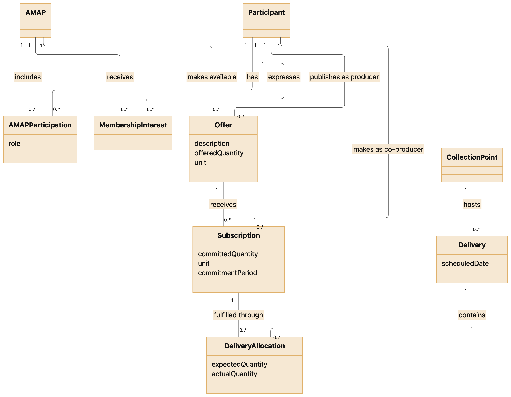
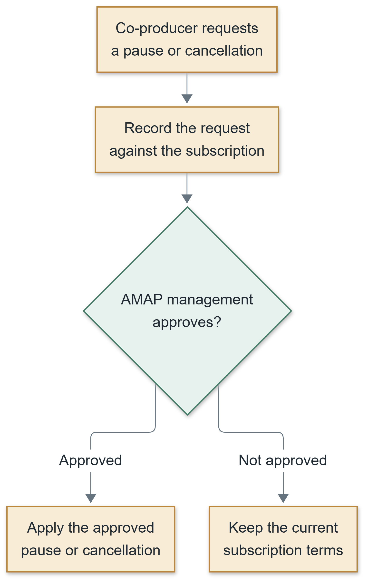
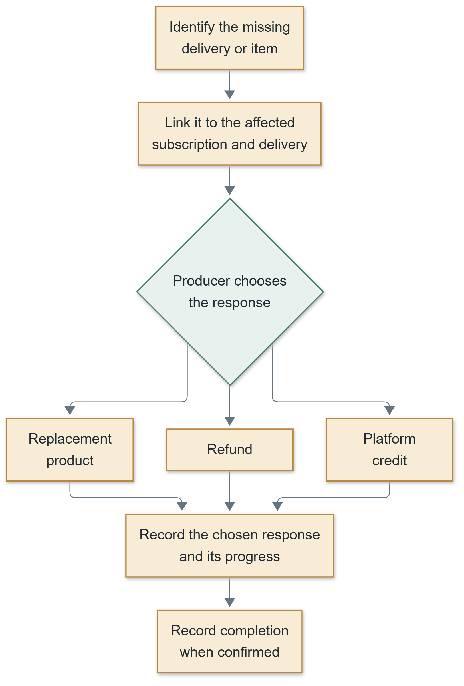
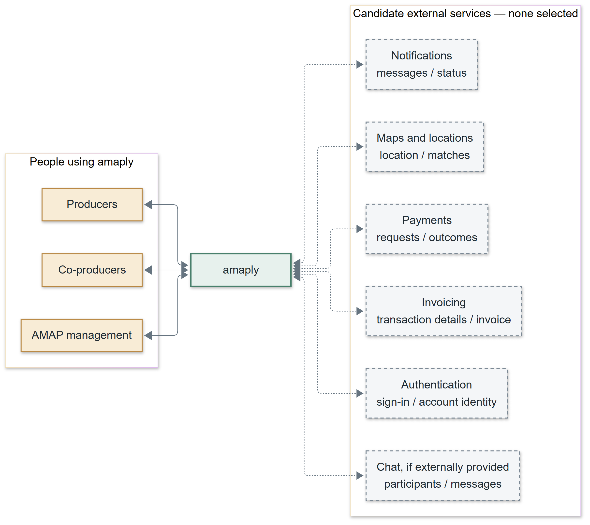

This template is a suggestion to complete the Software Requirements Specification (SRS) assignment as well the process used.

Please send comments and improvement opportunities to ajo@isep.ipp.pt.

Acknowledgements:

Sections of this document are based on the book Software Requirements (Third Edition) by Joy Beatty & Karl Wiegers and in the ISO/IEC/IEEE 29148.

Template revision history

| Version | Author        | Description               | Date       |
|---------|---------------|---------------------------|------------|
| 1.0     | António Rocha | Initial version           | 2017-10-07 |
| 1.1     | António Rocha | A few improvement details | 2018-10-04 |
|         |               |                           |            |

\<PROJECT\>

Software Requirements Specification – vERSION 1.0

\[Authors\]

\[Year\]

[1 Introduction [6](#introduction)](#introduction)

[1.1 Purpose [6](#purpose)](#purpose)

[1.2 Document conventions [6](#document-conventions)](#document-conventions)

[1.3 Project scope [6](#project-scope)](#project-scope)

[1.4 References [6](#references)](#references)

[2 Overall description [7](#overall-description)](#overall-description)

[2.1 Product Prespective [7](#product-prespective)](#product-prespective)

[2.2 User classes and characteristics [7](#user-classes-and-characteristics)](#user-classes-and-characteristics)

[2.3 Operating environment [7](#operating-environment)](#operating-environment)

[2.4 Design and implementation contraints [7](#design-and-implementation-contraints)](#design-and-implementation-contraints)

[2.5 Assumptions and dependencies [8](#assumptions-and-dependencies)](#assumptions-and-dependencies)

[3 Systems features [9](#systems-features)](#systems-features)

[3.1 Systema feature X [9](#systema-feature-x)](#systema-feature-x)

[3.1.1 Description [9](#description)](#description)

[3.1.2 Stimulus/Response Sequences [9](#stimulusresponse-sequences)](#stimulusresponse-sequences)

[3.1.3 Functional Requirements [9](#functional-requirements)](#functional-requirements)

[3.2 System feature y [10](#system-feature-y)](#system-feature-y)

[3.3 System feature z [10](#system-feature-z)](#system-feature-z)

[4 Data requirements [11](#data-requirements)](#data-requirements)

[4.1 Logical data model [11](#logical-data-model)](#logical-data-model)

[4.2 Data dictionary [11](#data-dictionary)](#data-dictionary)

[4.3 Reports [11](#reports)](#reports)

[5 Domain model [12](#domain-model)](#domain-model)

[5.1 Domain model overview [12](#domain-model-overview)](#domain-model-overview)

[5.2 Community and membership](#52-community-and-membership)

[5.3 Offers and commitments](#53-offers-and-commitments)

[5.4 Deliveries and communication](#54-deliveries-and-communication)

[6 External interface requirements [14](#external-interface-requirements)](#external-interface-requirements)

[6.1 User interfaces [14](#user-interfaces)](#user-interfaces)

[6.2 Software interfaces [14](#software-interfaces)](#software-interfaces)

[6.3 Hardware interfaces [14](#hardware-interfaces)](#hardware-interfaces)

[6.4 Communication interfaces [14](#communication-interfaces)](#communication-interfaces)

[7 Quality attributes [15](#quality-attributes)](#quality-attributes)

[7.1 Usability [15](#usability)](#usability)

[7.2 Performance [15](#performance)](#performance)

[7.3 Security [15](#security)](#security)

[7.4 Safety [15](#safety)](#safety)

[7.5 X \[Others\] [15](#x-others)](#x-others)

[8 Internationalization and localization requirements [16](#internationalization-and-localization-requirements)](#internationalization-and-localization-requirements)

[9 Other requirements [16](#other-requirements)](#other-requirements)

[10 Process adopted for elicitation [17](#process-adopted-for-elicitation)](#process-adopted-for-elicitation)

[10.1 Stakeholders [17](#stakeholders)](#stakeholders)

[10.2 Applied techniques [17](#applied-techniques)](#applied-techniques)

[10.3 Effort involved [17](#effort-involved)](#effort-involved)

[10.4 Constraints and limitations [18](#constraints-and-limitations)](#constraints-and-limitations)

[11 Product Backlog [19](#product-backlog)](#product-backlog)

[12 Appendix [20](#appendix)](#appendix)

[12.1 Appendix – Glossary [20](#appendix-glossary)](#appendix-glossary)

[12.2 Appendix – Analysis models [20](#appendix-analysis-models)](#appendix-analysis-models)

[12.3 Elicitation data detail [20](#elicitation-data-detail)](#elicitation-data-detail)

Document Approval

| Name | Title | Date | Signature |
|------|-------|------|-----------|
|      |       |      |           |
|      |       |      |           |
|      |       |      |           |
|      |       |      |           |

Revision history

| Version | Author | Description     | Date |
|---------|--------|-----------------|------|
| 1.0     | \<\>   | Initial version | \<\> |
|         |        |                 |      |
|         |        |                 |      |

# 1 Introduction

## 1.1 Purpose

\<Identify the product whose software requirements are specified in this document, including the revision or release number. Describe the different types of reader that the document is intended for, such as developers, project managers, marketing staff, users, testers, and documentation writers. \>

## 1.2 Document conventions

\<Describe any standards or typographical conventions that were followed when writing this SRS\>

## 1.3 Project scope

\<Provide a short description of the software being specified and its purpose, including relevant benefits, objectives, and goals. Relate the software to corporate goals or business strategies. If a separate vision and scope document is available, refer to it rather than duplicating its contents here.\>

## 1.4 References

\<List any other documents or Web addresses to which this SRS refers\>

# 2 Overall description

## 2.1 Product Prespective

\<Describe the context and origin of the product being specified in this SRS. For example, state whether this product is a follow-on member of a product family, a replacement for certain existing systems, or a new, self-contained product.

It is important one or more diagrams that shows the major components of the overall system and interconnections.\>

## 2.2 User classes and characteristics

\<Identify the various user classes that you anticipate will use this product, and describe their pertinent characteristics. User classes represent a subset of the stakeholders. User classes may be differentiated based on frequency of use, subset of product functions used, technical expertise, security or privilege levels, educational level, or experience. Describe the pertinent characteristics of each user class. Certain requirements may pertain only to certain user classes. Distinguish the most important user classes for this product from those who are less important to satisfy.\>

## 2.3 Operating environment

\<Describe the environment in which the software will operate, including the hardware platform, operating system and versions; geographical locations of users, servers, and databases, and any other software components or applications with which it must peacefully coexist.\>

## 2.4 Design and implementation contraints

\<Describe any items or issues that will limit the options available to the developers. These might include: corporate or regulatory policies; hardware limitations (timing requirements, memory requirements); interfaces to other applications; specific technologies, tools, and databases to be used; parallel operations; language requirements; communications protocols; security considerations; design conventions or programming standards (for example, if the customer’s organization will be responsible for maintaining the delivered software).\>

## 2.5 Assumptions and dependencies

\<List any assumed factors (as opposed to known facts) that could affect the requirements stated in the SRS. These could include third-party or commercial components that you plan to use, issues around the development or operating environment, or constraints. The project could be affected if these assumptions are incorrect, are not shared, or change.\>

# 3 Systems features

\<This template illustrates organizing the functional requirements for the product by system features, the major services provided by the product. You may prefer to organize this section by use case, mode of operation, user class, object class, functional hierarchy, or combinations of these, whatever makes the most logical sense for your product.\>

## 3.1 Systema feature X

> State the name of the feature in just a few words, such as “3.1 Spell Check”. Repeat section 3.x for each system feature. You can also group the features by area.

### 3.1.1 Description

> \<Provide a short description of the feature and indicate whether it is of High, Medium, or Low priority. You could also include specific priority component ratings, such as benefit, penalty, cost, and risk (each rated on a relative scale from a low of 1 to a high of 9).\>

### 3.1.2 Stimulus/Response Sequences

> \<List the sequences of user actions and system responses that stimulate the behavior defined for this feature. These will correspond to the dialog elements associated with use cases.\>

### 3.1.3 Functional Requirements

> \<Itemize the detailed functional requirements associated with this feature. These are the software capabilities that must be present in order for the user to carry out the services provided by the feature, or to execute the use case. Requirements should be concise, complete, unambiguous, verifiable, and necessary.
>
> \<Each requirement should be uniquely identified with a sequence number or a meaningful tag of some kind.\>
>
> REQ-1:
>
> REQ-2:

## 3.2 System feature y

## 3.3 System feature z

# 4 Data requirements

This section defines the information amaply keeps about participants, offers, subscriptions and deliveries. Proposed structures are labelled; unresolved business rules are summarised in Section 4.2.

Source references used in Sections 4, 5, 6 and 8:

| Reference | Repository source | Use |
| --- | --- | --- |
| S4-01 | docs/elicitation/session-notes.en.md, Questions 1, 2, 4 and 5 | Participants, offers, subscriptions, deliveries, membership and waiting lists. |
| S4-02 | docs/elicitation/session-notes.en.md, Questions 6, 7, 9 and 10 | International scope, preferences, seasonal variation, production evidence and payment/invoicing uncertainty. |
| S4-03 | docs/elicitation/open-questions.en.md | Earlier open questions, superseded by S4-06 where answered. |
| S4-04 | docsoldgroup/notas-entrevistas/notas-entrevista-biogoods-amap.md | Supplementary producer evidence: participation in several AMAPs, monthly amounts, delivery variation and collection records. |
| S4-05 | docsoldgroup/notas-entrevistas/notas-entrevista-coprodutor-Luisa-Marques.md | Supplementary co-producer evidence: order summaries, amounts owed by producer, calendars, preferences and collection difficulties. |
| S4-06 | docs/elicitation/ENGREQ_Interview_Questions_and_Answers.md | Payments, management decisions, subscription changes, missing deliveries, collection and languages. |

In S4-06, P1-P6 identify producer questions, C1-C6 co-producer questions, and A additional findings. Preferences and analysis proposals are distinguished from agreed rules.

## 4.1 Logical data model

The following groups describe business information and its relationships, independently of database design.

| Information group | What it represents | Source or reasoning |
| --- | --- | --- |
| Participant | A producer or co-producer; combined account roles remain open (Section 4.2). | S4-01, Q1-Q2. |
| AMAP | A community connecting producers and co-producers. It may have several collection points and chooses whether to accept payments through amaply or externally. | S4-01, Q1-Q2 and Q5; S4-06, P1 and A. |
| AMAP participation | Links a participant to an AMAP and their role. Participants may join several AMAPs. | S4-01, Q1; S4-04; S4-06, C4 and A. Separate participation records are proposed. |
| Membership interest | Records interest in joining or waiting for a place. Producers do not decide admissions. | S4-01, Q5; S4-06, P4 and C4. |
| Offer | Describes a seasonal basket or an individual product, with its producer, quantity and relevant AMAP. A person may browse an AMAP's products and subscription options before joining. | S4-01, Q2 and Q5; S4-06, C2, C4 and A. Linking the offer to an AMAP is proposed. |
| Subscription | One co-producer's commitment to one offer, quantity and period. Pausing or cancelling requires AMAP management approval. | S4-01, Q2 and Q5; S4-06, P3 and C3. |
| Delivery | Records a distribution date set by AMAP management and its collection point. Delivery allocations link subscriptions to their expected and actual quantities. The AMAP may offer several collection points. | S4-01, Q4; S4-02, Q7; S4-06, P4 and A. The allocation record is proposed. |
| Production evidence | A certificate, photograph or description associated with a producer's production practices. | S4-02, Q9. |
| Communication | News, notices and chat, with sender, recipients and relevant AMAP or delivery. | S4-01, Q1 and Q4; S4-02, Q7; S4-06, C3. Message fields are proposed. |
| Amounts by producer | Commitments and amounts separated by producer, with the AMAP's payment arrangement. Producers need funds before delivery; combined payment is preferred where feasible. | S4-06, P1 and C1. |
| Subscription change request | Links a pause or cancellation request to its subscription and management decision. | S4-06, P3 and C3; proposed record structure. |
| Missing-delivery resolution | Links the missing delivery or item to the producer's chosen response: replacement product, refund or platform credit. The record distinguishes the choice from its completion. | S4-06, P2. Recording the outcome separately is proposed. |
| Platform credit | Credit value, currency, co-producer and related producer for a missing delivery. | S4-06, P2; proposed record structure. Use and settlement rules remain open. |
| Absence arrangement | Records an advance absence and the co-producer's choice of another collector, an institution or other co-producers receiving the food. Managing baskets left uncollected is outside the required workflow. | S4-06, P5. |

The following rules keep the data consistent. Analysis proposals require validation.

| ID | Data rule | Source and rationale |
| --- | --- | --- |
| DR-01 | Each offer shall identify its producer, and each subscription shall identify its co-producer and subscribed offer. | S4-01, Q2. These links show who supplies the food and who has committed to receiving it. |
| DR-02 | A subscription shall record the agreed quantity, unit and commitment period. | S4-01, Q2. Distinguishes a recurring commitment from a one-off quantity. |
| DR-03 | Delivery data shall distinguish quantities expected under the commitment from quantities actually delivered. | S4-02, Q7. Keeping both values allows seasonal changes to be reviewed while preserving the original agreement. |
| DR-04 | Quantities shall be compared or added together only when they describe compatible products and units. | Analysis derived from S4-01, Q2 and S4-02, Q7. For example, a count of baskets cannot simply be added to a weight of vegetables. |
| DR-05 | The model shall allow different commitment periods and delivery schedules. AMAP management sets the delivery calendar, and the model shall allow several collection points for one AMAP. | S4-01, Q2 and Q4; S4-06, P4 and A. Detailed scheduling rules remain open. |
| DR-06 | A pause or cancellation shall take effect only after AMAP management approves it. | S4-06, P3 and C3. The request and decision must be distinguishable; deadlines and financial effects remain open. |
| DR-07 | A missing-delivery record shall identify the affected commitment and the producer's chosen response: replacement product, refund or platform credit. | S4-06, P2. An automatic refund for every seasonal variation is not established. |
| DR-08 | Each AMAP's choice of payments through the platform or externally shall be recorded. Platform payment arrangements shall not make delivery a condition for producers to access funds. | S4-06, P1 and A. Funds are needed to finance production. |
| DR-09 | If a combined payment is implemented, its record shall retain the breakdown by AMAP, producer and commitment. | Proposed from the combined-payment preference in S4-06, P1 and C1; supports reconciliation without merging commitments. |
| DR-10 | An absence arrangement shall refer to the affected delivery and the co-producer's selected collection alternative. | S4-06, P5. Detailed contact fields and any permissions for the alternative collector remain open. |

A missing delivery can be resolved by replacement, refund or credit. Automatic refunds for seasonal variation, guaranteed weights and quality-complaint procedures are not established. [S4-06, P2 and C2]

## 4.2 Data dictionary

The dictionary defines the data and its meaning. Types describe business values rather than storage formats.

| Data element | Kind of information | Meaning and rules | Source or reasoning |
| --- | --- | --- | --- |
| Record identifier | Identifier | A reference that distinguishes one record from another and lets related records be linked. | Proposed analysis convention for Section 4.1. |
| Participant name | Text | Name identifying the producer or co-producer in the community. | S4-01, Q2. |
| Participation role | Role | Producer, co-producer or AMAP management responsibility within an AMAP. | S4-01, Q1-Q2; S4-06, P3-P4. |
| AMAP name | Text | Name identifying the community in discovery and participation records. | Derived from S4-01, Q5. |
| Collection location | Location description | Physical place where food is delivered and collected. An AMAP may have several locations, and each scheduled delivery identifies its applicable point. Mapping provider and coordinate format remain undecided. | S4-01, Q4-Q5; S4-06, A. |
| Membership interest / waiting entry | Membership record | Interested co-producer, AMAP and whether they are waiting for a place. | S4-01, Q5; S4-06, P4. |
| Offer description | Text | Identifies the food product or basket offered by a producer. | S4-01, Q2; S4-02, Q6. |
| Offered quantity and unit | Quantity and unit | Quantity made available by the producer, expressed in the relevant product or basket unit. | S4-01, Q2; unit representation is derived. |
| Committed quantity and unit | Quantity and unit | Quantity requested by the co-producer under the subscription, together with its unit. Valid quantity increments depend on the offer and remain to be confirmed. | S4-01, Q2. |
| Commitment period | Period | Start and end, or equivalent agreed duration, of the subscription commitment. | S4-01, Q2 and Q4. |
| Delivery schedule | Dates and times | Delivery dates and collection times set by AMAP management. Unsuitable dates can be discussed within the AMAP. | S4-06, P4. Detailed change and notice rules remain open. |
| Expected / actual delivery quantity | Quantity and unit | What was expected and what was actually delivered for one subscription on a delivery date. A quantity not yet recorded must be distinguishable from zero. | Proposed representation derived from S4-02, Q7. |
| Product preference | Preference description | Food preferences supplied by the co-producer. The evidence does not establish allergy management or guaranteed substitution. | S4-02, Q6; S4-05. |
| Production evidence | Document, image or text | Certificate, photograph or description supplied by the producer. Accepted file formats, size limits and visibility are open. | S4-02, Q9. |
| Communication content | Text and message context | News, notices or chat content. Proposed supporting fields identify the sender, recipients and any related AMAP, subscription or delivery. | S4-01, Q1 and Q4; S4-02, Q7; S4-06, C3. |
| Amount for a producer | Monetary amount and currency | Amount associated with the producer's offers; refunds and credit are recorded separately. | S4-06, P1-P2 and C1. Currency is proposed for international use. |
| Collection record | Optional delivery-related record | Records collection if the AMAP adopts confirmation. Confirmation roles remain open. Pickup identity verification is not required by default, and managing baskets left uncollected is not required. | S4-04; S4-05; clarified scope in S4-06, P5. |
| Payment arrangement | AMAP setting | Whether the AMAP accepts payment through amaply or externally. The full list of supported methods is still to be agreed. | S4-06, P1 and A. |
| Pause or cancellation request | Request and decision | Subscription, requested action, proposed effective date, decision and approving management member. | S4-06, P3 and C3; field structure is proposed. |
| Resolution choice and progress | Choice and outcome | Replacement product, refund or platform credit for a missing delivery, with the affected allocation and the progress of the chosen response. Monetary responses include amount and currency. | S4-06, P2; tracking progress is proposed. |
| Credit record | Monetary amount and currency | Credit awarded for a missing delivery and its associated producer and co-producer. Rules for using and settling credit remain open. | S4-06, P2; record fields are proposed. |
| Absence and alternative collection | Delivery-related arrangement | Advance notice that the co-producer cannot collect, with their choice of another person, an institution or other co-producers receiving the food. | S4-06, P5. |
| Interface language | Language choice | Portuguese or English as the priority supported languages. Additional languages and exact variants remain to be agreed. | S4-06, C6. |

Remaining business decisions: admission responsibility and waiting-list priority; combined account roles and membership exit; pause/cancellation dates and financial effects; joining, transfers and renewals; price calculation, billing schedules, payment recipients, reconciliation, credit use and invoice responsibility; seasonal balance and quality complaints. Required personal data, field limits, access rights, status values and retention periods also need agreement. [S4-03; S4-06; analysis questions]

## 4.3 Reports

The following reports may be views on screen. Permissions, historical changes, export and print formats, automatic distribution and generation frequency remain to be agreed.

| ID | Report and intended user | What it shows | Source and rationale |
| --- | --- | --- | --- |
| REP-01 | Subscription summary for a co-producer | Subscribed offers, producers and AMAPs, quantities and units, commitment periods, delivery dates and collection points. Show any pause or cancellation request separately from an approved change. | S4-01, Q2, Q4 and Q5; S4-06, P3 and C3-C4. |
| REP-02 | Delivery preparation summary for a producer | For a selected delivery, AMAP and collection point, the subscribed co-producers and products, baskets and quantities to prepare. Show advance absence arrangements where relevant. Totals use compatible products and units. | S4-04; S4-06, P5 and A. The consolidated view is proposed. |
| REP-03 | Amount summary for a co-producer | Amounts by producer and AMAP, currency, billing basis, refunds and credit. A combined total is desired where payment arrangements and currencies allow. Paid and outstanding amounts depend on agreed reconciliation rules. | S4-06, P1-P2 and C1. Combined payment is a preference. |
| REP-04 | Seasonal quantity summary for a producer and the relevant co-producer | Expected and actual delivery quantities over the selected commitment period, shown separately by subscription, type of produce and compatible unit. Quantities not yet recorded are marked as such. | S4-02, Q7. Supports review of abundance and scarcity; the balance calculation remains open. |
| REP-05 | Missing-delivery follow-up for the producer and affected co-producer | The affected delivery or item, chosen replacement, refund or credit, and recorded progress. Do not present a chosen refund as completed before its outcome is recorded. | S4-06, P2. The report and progress distinction are proposed. |

Report access must be specified before exposing other participants' personal or financial information. [Analysis proposal based on the data in Section 4.2.]

# 5 Domain model

The domain model explains how the people, communities and commitments relate. Section 4 defines their data.

Sources are listed in Section 4. The three areas below organise the business concepts.

## 5.1 Domain model overview

An AMAP connects producers and co-producers through commitments over an agreed period. Producers deliver food to collection points; quantities and contents may vary with the harvest. [S4-01, Q1-Q4; S4-02, Q7]

The diagram shows the core model. Approval requests, payment arrangements, resolutions, credit and absences are described in Section 4 and the text below.

Figure 5.1 ? Core domain model. Sources and modelling choices are described in the relationship table below.

| Relationship | Meaning | Basis |
| --- | --- | --- |
| AMAP and its members | An AMAP can have several producers and co-producers. People can participate in more than one AMAP. | S4-01, Q1; S4-04; S4-06, C4 and A. |
| Producer and offer | Each offer identifies the producer responsible for it. A producer can publish several offers, such as a basket and additional products. | S4-01, Q2; S4-04. |
| Offer and subscription | A subscription records one co-producer's commitment to one offer. Several co-producers can subscribe to the same offer. A co-producer can have subscriptions with different producers. | S4-01, Q2 and Q5; S4-05. Representing each offer commitment separately is the modelling choice introduced in Section 4. |
| Subscription and delivery | A subscription can cover several deliveries. A delivery can serve several subscriptions. Each delivery allocation records what is expected and what is actually delivered for one subscription. | S4-01, Q2 and Q4; S4-02, Q7. The allocation is a proposed way to represent this relationship. |
| Delivery and collection point | An AMAP may offer several collection points. Each scheduled delivery identifies its collection point, which can be used again on other dates. | S4-01, Q4; S4-06, A. Reusing a collection-point record is a modelling choice. |

For example, commitments to one producer's basket and another producer's eggs remain separate subscriptions, even when collected together. [S4-01, Q2 and Q4; S4-05]

## 5.2 Community and membership

Membership links a person to an AMAP; a subscription links them to a specific offer. Joining a community does not itself place an order. [S4-01, Q1-Q2 and Q5; modelling distinction]

People can browse nearby AMAPs, products and subscription options before joining, and may join several communities. A waiting list records interest when no places are available. Producers do not decide admissions. [S4-01, Q5; S4-06, P4, C4 and A]

AMAP management sets the delivery calendar and approves pauses and cancellations. Unsuitable dates can be discussed internally. [S4-06, P3-P4 and C3]

Each AMAP chooses payments through amaply or externally and may offer several collection points. Remaining membership and permission decisions are listed in Section 4.2. [S4-06, P1 and A]

## 5.3 Offers and commitments

An offer describes a basket or individual product; a subscription records the agreed quantity and period. The co-producer favours seasonal vegetable baskets, with items such as eggs, milk and bread selected individually. [S4-01, Q2 and Q5; S4-06, C2]

The commitment period says how long the agreement lasts; the schedule says when deliveries occur. A several-month commitment may, for example, have fortnightly deliveries. [S4-01, Q2 and Q4; S4-04]

Food preferences guide the producer without guaranteeing substitutions or allergy management. [S4-02, Q6; S4-05]

Producers need funds before delivery. The co-producer prefers one payment across AMAPs, distributed by the AMAP, without paying the whole season at once. Combined payment and distribution remain preferences; recipient and invoicing arrangements are unresolved. [S4-06, P1 and C1]

A pause or cancellation changes the commitment only after AMAP management approval. A combined payment does not merge subscriptions. Other change rules remain open (Section 4.2). [S4-06, P3 and C3; modelling distinctions]

Figure 5.2 ? Pause and cancellation approval. [S4-06, P3 and C3; request records and process layout are proposed. Dates and financial effects remain open.]

## 5.4 Deliveries and communication

A delivery links subscriptions to a date and collection point. Allocations record expected and delivered quantities. Collection confirmation is an optional proposal, separate from delivery recording; managing baskets left uncollected is not required. [S4-02, Q7; S4-04; S4-05; S4-06, P4-P5]

The producer chooses how to resolve a missing delivery, as shown below. Credit-use and seasonal-balance rules remain open (Section 4.2). [S4-06, P2]

Figure 5.3 ? Missing-delivery response. [S4-06, P2; record links and progress tracking are proposed.]

Communication includes collection notices, farm news, producer reminders and requested in-platform chat. Informal discussion and help from AMAP management are preferred to a formal dispute process. Reminder timing and chat details are covered in Section 6. [S4-01, Q4; S4-02, Q7; S4-06, P5 and C3]

A co-producer reporting an absence is prompted to choose another collector, an institution or other co-producers receiving the food. Pickup identity verification is not required by default; an AMAP may choose it. [S4-06, P5]

# 6 External interface requirements

This section defines the views and exchanges needed for users, external services and devices.

Sources are listed in Section 4. Workflows follow the session notes and S4-06; service providers and technical details remain undecided. Analysis proposals are labelled.

## 6.1 User interfaces

The following views group related information and actions. Each shall identify the relevant producer and AMAP. [S4-01, Q1-Q2; S4-04; grouping into views is proposed]

| ID | View and user | Information and actions | Source or reasoning |
| --- | --- | --- | --- |
| UI-01 | AMAP discovery, for a person looking for a community | Browse AMAPs geographically and view their collection points, products and subscription options before joining. Express interest in joining or register interest on a waiting list when there are no places. | S4-01, Q5; S4-06, C4 and A. Admission steps and waiting-list priority remain open. |
| UI-02 | Offers and subscriptions, for a co-producer | Show the producer, basket or individual product, quantity, unit, commitment period and delivery schedule. Support seasonal baskets alongside individually selected products. Let the person review the commitment before submitting it. | S4-01, Q2 and Q5; S4-06, C2. Review before submission is proposed. |
| UI-03 | Personal subscription summary, for a co-producer | Show subscriptions across their AMAPs, producers, quantities, commitment periods, collection dates and locations. Distinguish a requested pause or cancellation from an approved change. | S4-06, P3, C3-C4 and A; S4-01, Q2 and Q4. See REP-01. |
| UI-04 | Offer and delivery preparation, for a producer | Allow the producer to describe offers and quantities, view commitments to their offers, and see what to prepare for a selected delivery and AMAP. | S4-01, Q2; S4-04. The preparation summary is proposed in REP-02. |
| UI-05 | Producer presentation, for producers and people viewing their information | Allow a producer to add certificates, photographs or descriptions of production practices and make the agreed information available to its intended audience. | S4-02, Q9. File limits and visibility rules remain open. |
| UI-06 | Delivery information and community news, for producers and co-producers | Show collection details, farm news, harvest changes and relevant notices. Provide producers with delivery reminders. | S4-01, Q1 and Q4; S4-02, Q7; S4-06, P5. One day before delivery is an example; exact timing and channels remain open. |
| UI-07 | Amounts and payment options, for a co-producer | Show amounts by producer and AMAP, currency, payment route, refunds and credit. Support the AMAP's payment choice. Combined payment across AMAPs without full-season prepayment is a preference to investigate. | S4-06, P1-P2 and C1; REP-03. |
| UI-08 | Advance absence arrangements, for a co-producer | Prompt an absent person to choose another collector, an institution or other co-producers receiving the food. Collection confirmation is optional; managing uncollected baskets is not required. | S4-06, P5. Pickup verification is optional; deadlines and contact fields remain open. |
| UI-13 | Calendar and subscription decisions, for AMAP management | Set the delivery calendar and approve or reject pause/cancellation requests. Distinguish submission from approval. | S4-06, P3-P4 and C3; approval display is proposed. |
| UI-14 | Missing-delivery resolution, for a producer | Select replacement, refund or credit for the affected item or delivery. Show the co-producer the response and recorded progress. | S4-06, P2; progress display is proposed. |
| UI-15 | In-platform chat, for direct discussion | Support informal discussion and help from AMAP management. | Requested in S4-06, C3; detailed access and retention rules remain open. |

The following presentation rules are proposed for clarity and consistency. [S4-01, Q1 and Q6; S4-05]

| ID | Proposed presentation rule | Reason |
| --- | --- | --- |
| UI-09 | Use the same terms throughout the interface, including producer, co-producer, offer, subscription and delivery. | Keeps the interface consistent with the domain model in Section 5. |
| UI-10 | Show quantity units beside quantities and currencies beside amounts. Explain how often a price applies when that basis is known. | Helps people distinguish a monthly amount, a price per product and a delivery quantity. |
| UI-11 | After a submission, say whether it was saved. If a field needs correction, identify it and explain what the user should change. | Prevents uncertainty about whether an offer or commitment was recorded. |
| UI-12 | Present expected quantities and actual delivery quantities with different labels. | Makes seasonal variation visible without confusing the agreement with the delivery record; see DR-03. |

Layouts, accessibility targets, screen sizes, browser support and the complete permission model need validation. A web interface for phones and computers is proposed; a native application is undecided.

## 6.2 Software interfaces

The following service interfaces are candidates for supporting the agreed workflows. Providers and versions remain undecided. [S4-03; S4-06, P1, P5, C3-C4 and A]

Figure 6.1 ? Interface overview. Solid lines show user interaction; dashed lines show candidate integrations. No providers are selected. [S4-03; S4-06, P1, P5, C3-C4 and A; proposed interface layout.]

| Candidate interface | Information sent and received if adopted | Purpose and open decisions |
| --- | --- | --- |
| Notification service | Send the recipient address for the selected channel, message content and delivery or community reference; receive acceptance or failure information. | Notify co-producers about collection and remind producers before delivery. One day before delivery is an example; timing and channels remain to be agreed. [S4-01, Q4; S4-06, P5] |
| Location or mapping service | Send the location entered or selected by the user; receive matching places, coordinates or distances as needed. | Support geographic AMAP discovery and several collection locations per AMAP. Provider and device-location access remain undecided. [S4-06, C4 and A] |
| Payment service | Send a payment request with amount, currency, intended recipient and reference; receive its outcome. Exchanges for refunds, allocation or settlement must be defined if required by the selected payment arrangement. | Support AMAP-selected platform payments alongside external payments. Producers must be able to access funds before delivery. Combined payments are desired where feasible; recipient, fees, method list and reconciliation remain open. [S4-06, P1-P2 and C1] |
| Invoicing service | Exchange the seller, customer and transaction details required by an agreed invoicing process, and receive the invoice reference or document. | Support invoicing if an integration is selected. Who issues invoices and whether integration is needed are unresolved. [S4-02, Q10; S4-03] |
| External authentication service | Exchange the information needed to establish a user session and identify the account, according to the selected sign-in method. | Support sign-in if an external identity provider is chosen. The provider, protocol and account-linking rules remain open. [S4-03] |
| Optional chat service | If an external chat product is selected, exchange sender and recipient identifiers, message content and any agreed delivery information. | In-platform chat is requested, but using an external service is not a requirement. Permissions, retention, provider and protocol remain open. [S4-06, C3] |

Each selected integration needs a provider/version, message fields and format, authentication method and failure behaviour. The table gives preliminary exchanges.

MB Way and bank transfer are current methods; cash is not normally used. Apple Pay and PayPal were suggestions. The supported method list remains open. [S4-06, C1]

## 6.3 Hardware interfaces

No dedicated hardware interface is currently required. Phones and computers are proposed for portal access; supported devices and operating conditions remain undecided. [S4-01, Q4; S4-02, Q6; S4-04]

File uploads in UI-05 do not require direct camera or scanner control. Weighing scales, payment terminals and barcode readers have no specified integration. [S4-02, Q9]

Pickup verification is optional; any required verification device would need a separate interface specification. [S4-06, P5]

## 6.4 Communication interfaces

Communication channels and protocols remain to be selected. The following rules cover notifications, chat and service responses. [S4-01, Q1 and Q4; S4-02, Q7; S4-06, P5 and C3]

| ID | Requirement or proposed rule | Source or reasoning |
| --- | --- | --- |
| COM-01 | Collection notifications shall identify the AMAP and collection location; date and time are proposed additions. Producers shall receive delivery reminders. | S4-01, Q4; S4-06, P5. One day before delivery is an example, not a fixed schedule. |
| COM-02 | Production news and explanations of harvest changes shall be available through the platform. The audience and any notification channel shall be agreed separately. | S4-02, Q7; audience and channel decisions remain open. |
| COM-03 | For the proposed web interface, use HTTPS for communication between the user's browser and amaply. | Proposed technical safeguard for the personal and financial information described in Section 4. Protocol configuration belongs to the later security specification. |
| COM-04 | If an external notification service is adopted, distinguish a message being accepted by that service from confirmed delivery to the recipient. A service failure shall not be shown as a successfully delivered notification. | Proposed rule to avoid giving users a misleading notification status. Delivery evidence depends on the selected service. |
| COM-05 | If a payment service is adopted, associate each received result with the payment request it concerns. Repeated delivery of the same result shall not create a second payment record. | Proposed rule to keep the amount summary consistent when an external service repeats a message. |
| COM-06 | Support in-platform chat and informal discussion with AMAP management. | Requested in S4-06, C3. Communication between separate AMAPs is unconfirmed. [S4-06, A] |

Remaining communication decisions: final reminder timing, channels, recipient rules, retries, message formats, chat access and retention, and response-time targets. Offline use and synchronisation are unconfirmed. Language rules are in Section 8. [S4-06, P5 and C3; analysis questions]

# 7 Quality attributes

This section specifies other nonfunctional requirements. These quality requirements should be specific, quantitative and verifiable.

## 7.1 Usability

Usability requirements deal with ease of learning, ease of use, efficiency and accessibility.

## 7.2 Performance

\<If there are performance requirements for the product under various circumstances, state them here and explain their rationale, to help the developers understand the intent and make suitable design choices.\>

## 7.3 Security

\<Specify any requirements regarding security or privacy issues surrounding use of the product or protection of the data used or created by the product. Define any user identity authentication requirements. Refer to any external policies or regulations containing security issues that affect the product. Define any security or privacy certifications that must be satisfied.\>

## 7.4 Safety

\<Specify those requirements that are concerned with possible loss, damage, or harm that could result from the use of the product. Define any safeguards or actions that must be taken, as well as actions that must be prevented. Refer to any external policies or regulations that state safety issues that affect the product’s design or use. Define any safety certifications that must be satisfied.\>

## 7.5 X \[Others\]

# 8 Internationalization and localization requirements

amaply is intended for international AMAP/CSA communities, with language and regional formats suited to its users. [S4-02, Q6]

Portuguese and English are the priority languages. LOC-01 records this need; language-selection behaviour and LOC-02 to LOC-08 are analysis proposals. [S4-06, C6; S4-02, Q6]

| ID | Requirement or proposed rule | Reason and basis |
| --- | --- | --- |
| LOC-01 | Provide Portuguese and English as the priority interface languages. User language selection and consistent translation of navigation, labels, instructions, errors and confirmations are proposed. | S4-06, C6 supports the languages; interaction details require validation. |
| LOC-02 | Text entered by users, including names, product descriptions and collection addresses, shall preserve accented characters and other characters used in the supported languages when saved and displayed. | Producer identity and collection details must remain understandable. Derived from S4-01, Q2 and Q4, and S4-02, Q6. |
| LOC-03 | Dates, times and numbers shall be displayed using the user's selected regional format. Entry fields shall make the expected format clear and interpret entries using that format. | Avoids confusing a delivery date or quantity because regional conventions differ. Derived from the quantities and delivery information in S4-01, Q2 and Q4. |
| LOC-04 | Collection times shall be associated with the collection point's time zone. The interface shall make clear that they are local times at that point, and scheduled deliveries shall retain their intended local collection time when seasonal clock changes apply. | A person viewing the portal from another time zone must still know when to collect food. Proposed from the international scope and collection process in S4-01, Q4, and S4-02, Q6. |
| LOC-05 | Each monetary amount shall have an identified currency. Formatting shall follow the selected regional convention, and amounts in different currencies shall not be added into a single total without an explicitly agreed conversion rule. | Keeps producer amounts meaningful across regions. Derived from S4-02, Q6 and Q10, and the financial summary in Section 4. Currency conversion is not established as a required feature. |
| LOC-06 | Quantities shall display their unit wherever a user enters, reviews or compares them. Changing the interface language or regional format shall not silently change the quantity or its unit. | Prevents a translation or formatting choice from changing a commitment. Derived from S4-01, Q2, and DR-02 and DR-04 in Section 4. |
| LOC-07 | Address and contact fields shall accommodate the formats of the supported countries. Labels and validation shall not assume one country's postal-code or telephone-number format for every user. | Collection points and participants may be in different countries. Proposed from S4-01, Q4, and S4-02, Q6; required contact fields remain open. |
| LOC-08 | System-generated notifications shall use the recipient's selected supported language, where available. They shall retain the intended collection point's local date and time and identify the currency and units where relevant. | Keeps notifications consistent with the information shown in the application. Derived from S4-01, Q4, and the notification interface in Section 6. |

Additional languages are desirable for later expansion. Exact variants and the default language remain open. [S4-06, C6]

User-written content and uploaded documents remain in their original language unless translated separately. Automatic translation and fallback behaviour are unconfirmed. [Analysis proposal based on S4-02, Q7 and Q9]

Translations should preserve the distinctions between membership, subscription and delivery in Section 5. Local terminology should be reviewed with the communities concerned. [Analysis proposal based on S4-01, Q1-Q2]

Remaining localization decisions: launch countries, language variants and default, currencies, units, regional formats, time zones and translation fallback. Payment and invoicing questions are listed in Section 4.2. [S4-06, P1, C1 and C6; analysis questions]

# 9 Other requirements

\<Define other requirements that are not covered elsewhere.\>

# 10 Process adopted for elicitation

\< Describe the methodology used to reach the requirements of this document\>

## 10.1 Stakeholders

\< Identify and describe stakeholders \>

## 10.2 Applied techniques

\<Describe the techniques used in gathering requirements (detail should be in the appendix)\>

## 10.3 Effort involved

Describe in detail the total effort, and per business analyst, involved in the production of this work.

| Task | Brief description |     BA name     | Hours |
|------|-------------------|:---------------:|:-----:|
| 1    | \<\>              | \<Jorge Lopes\> |   2   |
| 2    |                   |                 |       |
| 3    |                   |                 |       |
| 4    |                   |                 |       |
| 5    |                   |                 |       |
| 6    |                   |                 |       |
|      |                   |                 |       |
|      |                   |                 |       |
|      |                   |                 |       |
|      |                   |                 |       |
|      |                   |                 |       |

Audience and market table

> Total hours: xxx

## 10.4 Constraints and limitations

Describe, if any, constraints, limitations or other problem that occurred in the production of this work.

# 11 Product Backlog

Summary of all features presented in the form of user stories. An initial (IR) requirement may result in several user stories.

Provide an estimate of the development effort for each of the user stories. The effort must consider all stages of development.

Example:

<table>
<caption>Audience and market table</caption>
<colgroup>
<col style="width: 6%" />
<col style="width: 8%" />
<col style="width: 60%" />
<col style="width: 13%" />
<col style="width: 11%" />
</colgroup>
<thead>
<tr>
<th>US Nr.</th>
<th>
IR

Nr.
</th>
<th>User story</th>
<th style="text-align: center;">Estimative hours</th>
<th style="text-align: center;">Priority</th>
</tr>
</thead>
<tbody>
<tr>
<td>1</td>
<td>R001</td>
<td>&lt;&gt;</td>
<td style="text-align: center;">20h</td>
<td style="text-align: center;">1</td>
</tr>
<tr>
<td>2</td>
<td></td>
<td></td>
<td style="text-align: center;"></td>
<td style="text-align: center;"></td>
</tr>
<tr>
<td>3</td>
<td></td>
<td></td>
<td style="text-align: center;"></td>
<td style="text-align: center;"></td>
</tr>
<tr>
<td>4</td>
<td></td>
<td></td>
<td style="text-align: center;"></td>
<td style="text-align: center;"></td>
</tr>
<tr>
<td>5</td>
<td></td>
<td></td>
<td style="text-align: center;"></td>
<td style="text-align: center;"></td>
</tr>
<tr>
<td>6</td>
<td></td>
<td></td>
<td style="text-align: center;"></td>
<td style="text-align: center;"></td>
</tr>
<tr>
<td></td>
<td></td>
<td></td>
<td style="text-align: center;"></td>
<td style="text-align: center;"></td>
</tr>
<tr>
<td></td>
<td></td>
<td></td>
<td style="text-align: center;"></td>
<td style="text-align: center;"></td>
</tr>
</tbody>
</table>

To develop all the functionalities of this document the software house will need a total of X hours.

# 12 Appendix

## 12.1 Appendix – Glossary

\<Define all the terms necessary to properly interpret the SRS, including acronyms and abbreviations. You may wish to build a separate glossary that spans multiple projects or the entire organization, and just include terms specific to a single project in each SRS.\>

## 12.2 Appendix – Analysis models

\<Optionally, include any pertinent analysis models, such as data flow diagrams, class diagrams, state-transition diagrams, or entity-relationship diagrams*.\>*

## 12.3 Elicitation data detail

\<You can include here, data, statements, questions and answers made during the requirements gathering meetings.\>
