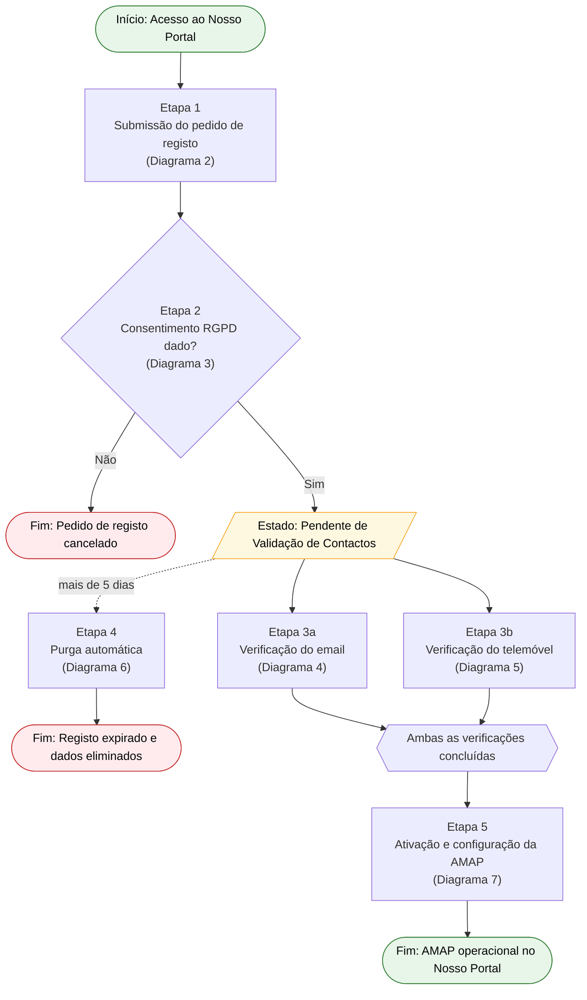
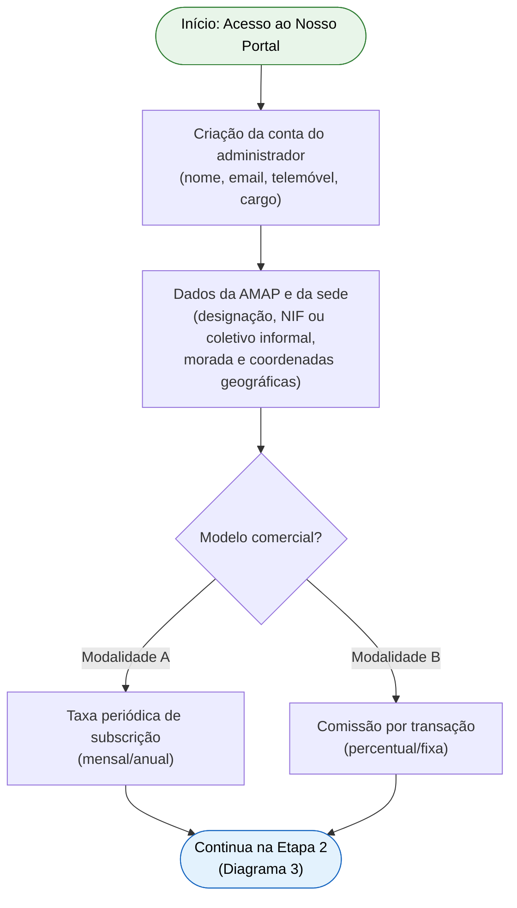
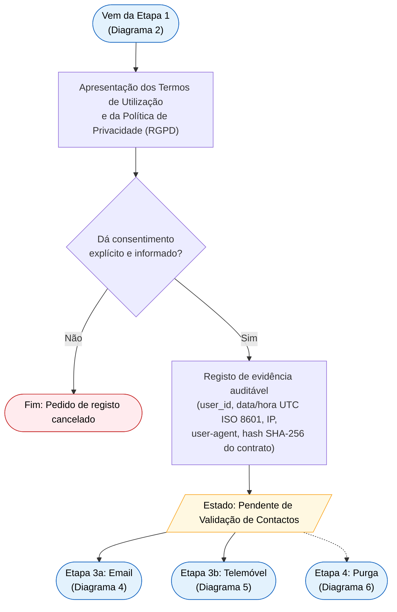
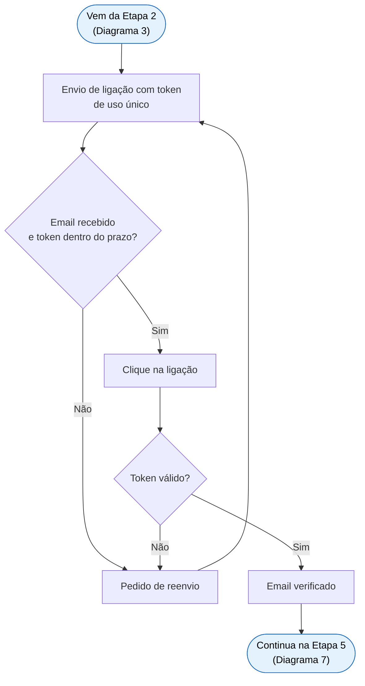
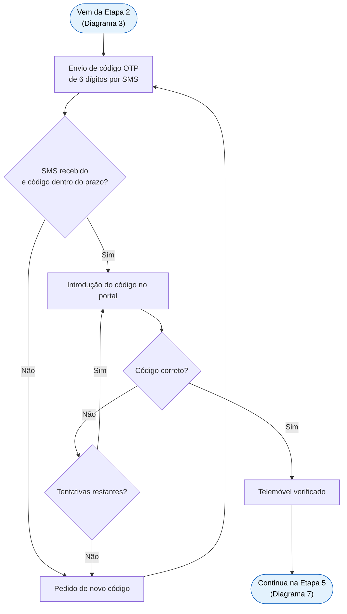
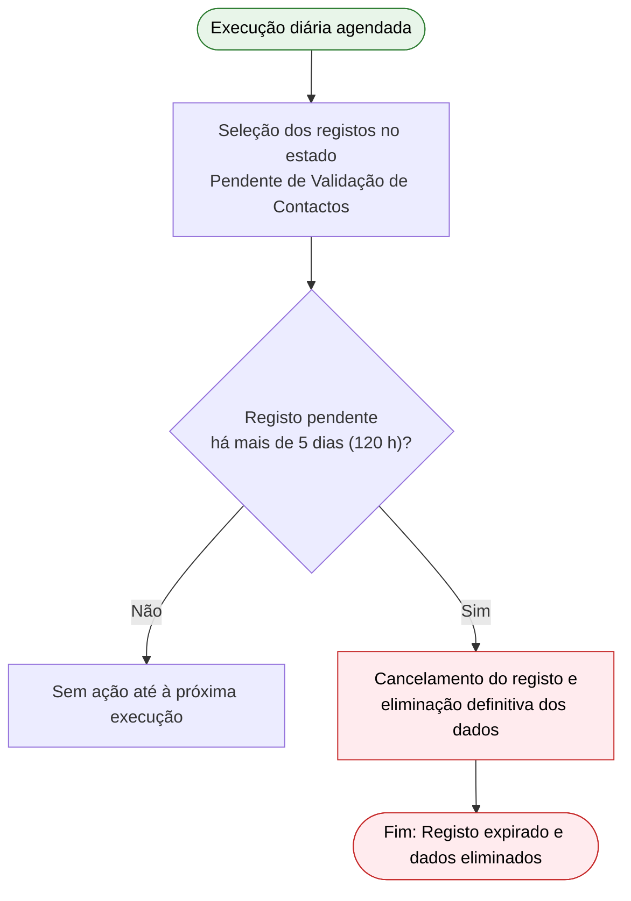
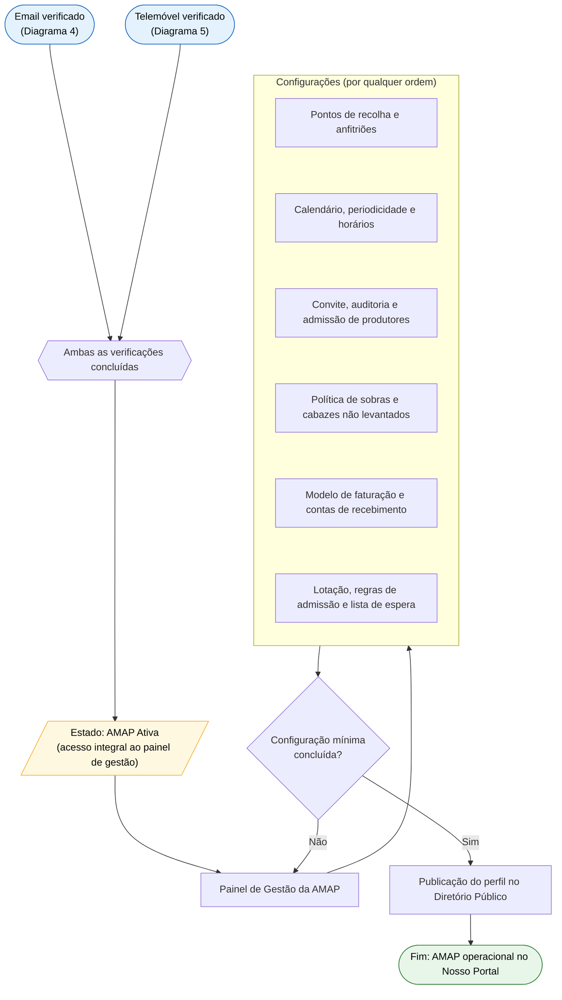
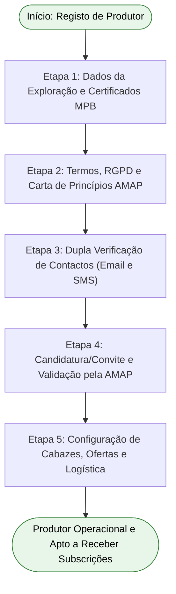
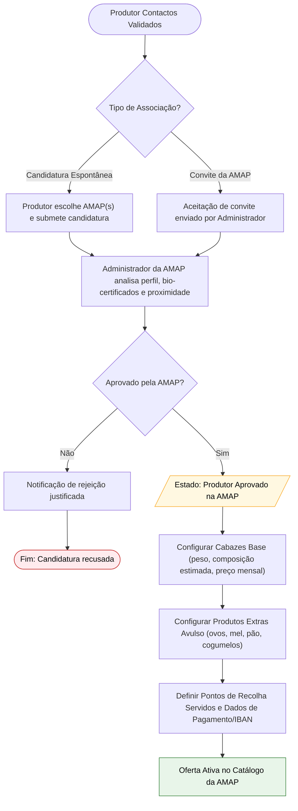
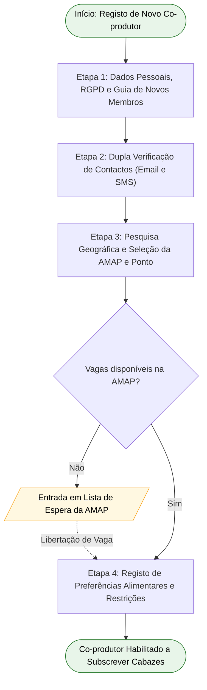

Jorge:
1. Introduction
2. Overall description

# Responsibilities
## AMAP
AMAP is responsible for:
1. Allowing new producers
2. Allowing new co-producers
3. Defining and publishing the AMAP terms and conditions and privacy policy to be accepted by producers and co-producers
4. Validating producers and ensure they are compliant
5. Defining the delivery locations
6. Defining the delivery date and time
7. Opening order periods (start and end dates, delivery dates and order deadline), making them available for Producers to fill in their offers, and then announcing them to Co-Producers
8. Keeping the AMAP documents and useful links available
9. Managing the annual membership fee, if applicable
10. Defining whether invoicing and payments are made directly to each Producer or through the AMAP (to be confirmed)

## Producers
Producers are responsible for:
1. Making sure they produce and deliver the goods they committed to
2. Comply with the schedule and delivery defined by AMAP 
3. Making the offer of the goods they want to sell on a subscription based model (baskets and individual products), for each order period opened by the AMAP
4. Following the AMAP principles (agroecology, direct sale without resale) and showing how they produce (certificates, photos, descriptions)
5. Announcing the content of the basket before each delivery, taking Co-Producers' preferences into account when/if possible
6. Balancing quantities over the period (abundance vs scarcity)
7. Transporting the goods to the pick-up point
8. When payments are made directly to them: defining the payment rules, confirming payments received and issuing invoices (to be confirmed)

## Co-Producers
Co-producers are responsible for:
1. Sign up for a subscription with one or more producers of the AMAPs they belong to (a Co-Producer can belong to more than one AMAP)
2. Comply with the subscription responsibility, namely:
	1. Ensure the payment of the subscription
	2. Picking up the goods at the place and schedule defined by AMAP
    3. Notifying in advance when they cannot pick up the goods and choosing what happens to the basket
    4. Confirming the pick-up of their basket
3. Respecting the seasonal commitment and sharing the agricultural risk (accepting variations in the harvest)
4. Paying the AMAP annual fee, if applicable

# Flows
## Onboarding
### AMAP Onboarding (Adesão e Ativação de AMAP no Nosso Portal)
O processo de adesão (*onboarding*) de uma nova AMAP/CSA no **nosso portal** rege-se pelas etapas e requisitos operacionais descritos abaixo. O Diagrama 1 apresenta a visão geral do processo; os diagramas seguintes detalham cada etapa. Os nós a azul indicam a ligação a outro diagrama.
TODO: Definir a forma de pagamento da AMAP ou comissão sobre transação

**Diagrama 1 – Visão geral do processo de adesão**

1. **Submissão do Pedido de Registo e Dados Institucionais:**
   - Criação da conta do utilizador administrador responsável (nome completo, correio eletrónico, contacto telefónico móvel e cargo institucional).
   - Dados de identificação da AMAP: designação oficial/comunitária da AMAP, NIF (caso possua personalidade jurídica) ou indicação de coletivo informal, morada completa da sede/núcleo (rua, localidade, código postal e coordenadas geográficas para geolocalização no mapa de núcleos).
   - Seleção do modelo comercial e de sustentabilidade face ao portal:
     - Modalidade A: taxa periódica de subscrição (*subscription fee* mensal/anual);
     - Modalidade B: comissão percentual/fixa sobre cada transação processada no portal.

**Diagrama 2 – Etapa 1: Submissão do pedido de registo**

2. **Conformidade Legal e RGPD (Declaração de Consentimento Informado):**
   - Apresentação obrigatória dos Termos de Utilização do Portal e da Política de Privacidade e Proteção de Dados (RGPD).
   - Consentimento explícito e informado para o tratamento e a partilha dos dados operacionais estritamente necessários entre administradores da AMAP, produtores e co-produtores.
   - Registo probatório e auditável em base de dados: identificador do utilizador (`user_id`), data/hora exata em fuso UTC (ISO 8601), endereço IP, identificador do dispositivo/navegador (*user-agent*) e versão/*hash* criptográfico (SHA-256) do contrato aceite.

**Diagrama 3 – Etapa 2: Conformidade legal e RGPD**

3. **Ciclo de Verificação Dupla de Contactos (Email e Telemóvel):**
   - **Ciclo de Correio Eletrónico:** envio de uma ligação com *token* criptográfico de uso único. Se o email não for recebido ou o *token* expirar, é permitido pedir o reenvio. Após o clique na ligação válida, o email fica marcado como verificado.
   - **Ciclo de Contacto Telefónico:** envio de um código OTP (*One-Time Password*) de 6 dígitos por SMS. Se o SMS não for recebido ou o código falhar/expirar, o utilizador pode tentar novamente ou pedir um novo envio. Após a introdução do código correto, o telemóvel fica marcado como verificado.
   - Os dois ciclos decorrem em paralelo. A conta permanece no estado `Pendente de Validação de Contactos` até que ambos sejam concluídos com sucesso.

**Diagrama 4 – Etapa 3a: Verificação do email**

**Diagrama 5 – Etapa 3b: Verificação do telemóvel**

4. **Política de Retenção e Purga Automática aos 5 Dias:**
   - Se o utilizador não concluir a validação integral do correio eletrónico e do telemóvel num prazo máximo predefinido de 5 dias seguidos (120 horas), o registo provisório é cancelado e definitivamente eliminado da base de dados através de uma rotina automática diária (*garbage collection*), libertando os dados e garantindo a estrita conformidade com o princípio da limitação da conservação (artigo 5.º, n.º 1, alínea e), do RGPD).

**Diagrama 6 – Etapa 4: Purga automática aos 5 dias**

5. **Ações Disponíveis para o Administrador após a Validação da AMAP:**
   Assim que ambos os contactos estão verificados e o registo da AMAP é validado, o utilizador administrador obtém acesso integral ao painel de gestão, ficando habilitado a:
   - **Configurar Locais e Pontos de Entrega (*Pick-up Points*):** registar os pontos físicos de recolha de cabazes (morada, referências de acesso, mapa, capacidade de armazenamento e anfitrião responsável).
   - **Definir o Calendário e a Frequência das Entregas:** estabelecer a periodicidade (semanal, quinzenal, intercalada), o dia da semana e a janela horária de levantamento dos cabazes.
   - **Convidar, Validar e Admitir Produtores:** enviar convites a agricultores locais, analisar candidaturas e auditar a conformidade agroecológica (métodos biológicos, proximidade geográfica e certificações).
   - **Parametrizar a Gestão de Não Levantamentos e Sobras:** definir a política comunitária para cabazes não levantados (doação a uma IPSS parceira, distribuição solidária pelos co-produtores ou oferta aos voluntários presentes) e os prazos de aviso prévio de ausência.
   - **Configurar o Modelo Financeiro e a Faturação:** definir o fluxo de faturação aos co-produtores (faturação direta emitida por cada produtor ou faturação centralizada pela AMAP) e configurar as contas de recebimento.
   - **Gerir Vagas e Co-produtores:** parametrizar a lotação máxima de famílias associadas, configurar as regras de admissão e gerir a lista de espera.
   - **Ativar a Publicação no Diretório Público:** disponibilizar o perfil público da AMAP no mapa e no portal de pesquisa, para adesão de novos co-produtores.

**Diagrama 7 – Etapa 5: Ativação e configuração da AMAP**

### Producer Onboarding
### Producer Onboarding (Adesão, Candidatura e Configuração do Produtor)
O processo de adesão de um produtor ao portal e a vinculação a uma ou mais AMAPs divide-se em 5 etapas principais:

1. **Submissão da Candidatura do Produtor e Dados da Exploração:**
   - Criação da conta do produtor (nome, email, telemóvel, dados fiscais/NIF e morada da exploração agrícola/quinta).
   - Caracterização da exploração: área cultivada, localização geográfica (coordenadas para cálculo de km alimentares), métodos de produção (Modo de Produção Biológico - MPB, agroecologia, práticas sustentáveis).
   - Carregamento de documentação comprovativa: certificados biológicos oficiais (se aplicável), licenças apícolas/pecuárias, fotografias da quinta e descrição das práticas de conservação do solo e recursos hídricos.
   - Aceitação do princípio fundador da AMAP: compromisso estrito de **venda direta sem revenda ou intermediação comercial**.

2. **Conformidade Legal, RGPD e Carta de Princípios:**
   - Consentimento explícito para partilha dos dados de contacto e faturação com os coordenadores de AMAP e co-produtores associados.
   - Aceitação formal da Carta de Princípios AMAP/CSA (partilha transparente de riscos, dignidade do trabalho rural e qualidade alimentar).
   - Registo probatório auditável (timestamp UTC ISO 8601, IP, user-agent e hash SHA-256 do documento aceite).

3. **Verificação de Contactos:**
   - Validação dupla em paralelo (ligação por email com token criptográfico e OTP por SMS), sujeita à mesma regra de retenção e purga de 5 dias caso não seja validada.

4. **Auditoria e Aprovação da Ligação à AMAP:**
   - O produtor pode submeter candidatura a uma AMAP existente ou ser convidado por um administrador de AMAP.
   - O administrador da AMAP analisa a conformidade agroecológica, proximidade geográfica e capacidade produtiva (podendo registar parecer de visita participativa à quinta).
   - Aprovação da admissão do produtor pela AMAP. Nota: um produtor pode estar associado a múltiplas AMAPs (ex.: abastecer AMAP 1 e 2 numa semana, e AMAP 3 e 4 na semana seguinte, equilibrando capacidade e colheitas).

5. **Configuração da Oferta e Logística de Entrega:**
   - **Definição de Cabazes Base:** configuração do "Cabaz da Quinta" ou "Cabaz de Época" (peso aproximado ~4 kg, periodicidade quinzenal ou semanal, preço mensal fixo sob subscrição, estimativa de itens sazonais).
   - **Definição de Produtos Complementares/Avulsos:** registo de ofertas adicionais (pão biológico de diferentes gramagens, cogumelos, azeite, ovos, mel, pólen) com respetivo preço unitário e eventuais descontos exclusivos para subscritores de cabaz.
   - **Parametrização Logística e Financeira:** seleção dos pontos de recolha servidos pela sua carrinha/transporte, dias de entrega atribuídos, e métodos de recebimento aceites (dados de IBAN para transferências diretas, número de telemóvel para MBWay ou integração com gateway do portal).

**Diagrama 8 – Visão geral do Onboarding de Produtor**

**Diagrama 9 – Detalhe da Auditoria e Configuração do Produtor**

### Co-Producer Onboarding (Adesão e Integração do Co-produtor / Consumidor)
O acolhimento de co-produtores rege-se pelos princípios da corresponsabilidade cidadã e da partilha de riscos:

1. **Criação de Conta e Consentimento Informado:**
   - Registo pessoal (nome, correio eletrónico, telemóvel, morada para georreferenciação de proximidade e NIF para faturação).
   - Apresentação e aceitação expressa da **Declaração de Consentimento RGPD** e do **Guia para a Entrada de Novos Co-produtores**, assegurando o pleno alinhamento com a filosofia AMAP (compreensão de que não se trata de um supermercado convencional, mas sim de um pacto solidário sazonal).
   - Registo auditável em base de dados com hash SHA-256 da aceitação dos termos.

2. **Verificação de Contactos:**
   - Dupla verificação de email (link com token) e telemóvel (código OTP de 6 dígitos por SMS).

3. **Descoberta e Seleção de AMAP / Ponto de Recolha:**
   - O utilizador pesquisa AMAPs no portal através de mapa interativo (geolocalização por raio de proximidade) ou por recomendação comunitária.
   - Seleção do Ponto de Recolha (*Pick-up Point*) pretendido e visualização do calendário de entregas e horários disponíveis.

4. **Verificação de Lotação e Gestão de Vagas:**
   - Se a AMAP/Ponto de Entrega tiver vagas disponíveis na lotação estipulada pelo grupo: transita imediatamente para a seleção de subscrições.
   - Se a lotação estiver esgotada: o co-produtor é integrado na **Lista de Espera** da AMAP com posição numerada transparente, sendo notificado automaticamente assim que surgir uma vaga (por desistência ou alargamento de capacidade dos produtores).

5. **Registo de Perfil de Preferências e Restrições Alimentares:**
   - O co-produtor pode declarar alergias, intolerâncias ou produtos indesejados (ex.: aversão a pepino ou aipo), permitindo ao produtor realizar substituições atempadas e equilibradas na montagem do cabaz.

**Diagrama 10 – Visão geral do Onboarding de Co-produtor**

## Ordering

## Paying

## Delivering

## Returns and Refunds

