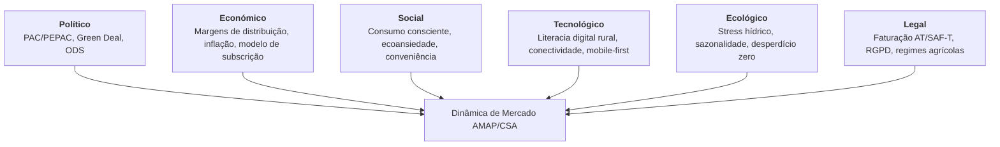
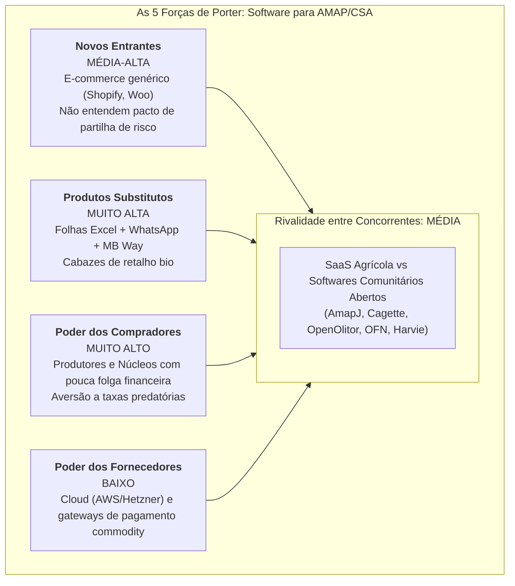
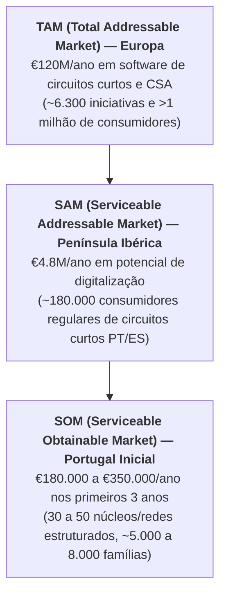

# Fase 1: Análise Estratégica e Dinâmica de Mercado (AMAP / CSA)

**Projeto:** FAIR Software Solutions — Plataforma para o Ecossistema AMAP/CSA  
**Módulo:** Engenharia de Requisitos (ENGREQ) — Super Stars (ISEP)  
**Âmbito Geográfico:** Portugal (Foco Primário), com extensão comparativa a Espanha, França e Europa  

---

## 1. Análise PESTEL (Contexto Portugal e Península Ibérica)

A análise PESTEL identifica as forças macroambientais que condicionam a adoção e sustentabilidade de uma solução de software para o modelo AMAP/CSA.

---

### 1.1. Fatores Políticos (Political)
* **Políticas Europeias (Pacto Ecológico Europeu & Estratégia do Prado ao Prato — *Farm to Fork*):** A União Europeia tem como meta que 25% da superfície agrícola utilizada (SAU) seja biológica até 2030. Há diretivas explícitas de apoio à redução de intermediários e à promoção de cadeias curtas de abastecimento alimentar (SFSC).
* **Quadro Nacional (PEPAC Portugal 2023–2027):** O Plano Estratégico da PAC em Portugal prevê apoios específicos à pequena agricultura familiar, incentivos à transição agroecológica e apoios aos Grupos de Ação Local (GAL) para dinamização de mercados locais e circuitos curtos de proximidade.
* **Agenda 2030 das Nações Unidas:** Alinhamento direto com o ODS 2 (Fome Zero e Agricultura Sustentável — Metas 2.3 e 2.4), ODS 11 (Comunidades Sustentáveis) e ODS 12 (Consumo e Produção Responsáveis).
* **Falta de Reconhecimento Jurídico Específico da CSA em Portugal:** Ao contrário de França, onde o conceito de AMAP é tutelado com base numa Carta Nacional consolidada (MIRAMAP) e reconhecido pelo Ministério da Agricultura, em Portugal as AMAP/CSA operam como movimentos associativos informais ou sob o formato de associações sem fins lucrativos (ex: Moving Cause) e cooperativas de utilizadores.

---

### 1.2. Fatores Económicos (Economic)
* **Esmagamento das Margens dos Pequenos Produtores:** No circuito de retalho convencional (grandes superfícies e grossistas), o pequeno agricultor recebe habitualmente menos de 20% a 30% do valor final pago pelo consumidor. No modelo AMAP/CSA, o produtor retém entre 85% e 100% do valor facial do cabaz, assegurando viabilidade económica e rendimento digno.
* **Inflação Alimentar e Poder de Compra:** O aumento dos custos de vida pressiona o orçamento familiar. No entanto, os estudos do INRAE (França) e do URGENCI demonstram que, ao eliminar margens de intermediários e custos de embalamento supérfluo, o cabaz AMAP por quilograma de alimento biológico é frequentemente **mais económico ou comparável** ao cabaz equivalente em supermercados convencionais.
* **Modelo Financeiro de Partilha de Risco (Financiamento a Montante):** A adesão por temporada (com pagamento adiantado integral ou tranches programadas) assegura ao agricultor tesouraria e capital de maneio garantido no início da época de cultivo, blindando-o contra a volatilidade especulativa de mercado.
* **Custo de Intermediação Tecnológica:** As explorações agrícolas familiares operam com liquidez restrita; soluções de software que cobrem comissões percentuais elevadas sobre as transações (como as plataformas de delivery tipo UberEats/Glovo com taxas de 20-30%) são terminantemente rejeitadas no movimento CSA. O modelo de custeio do software FAIR tem de assentar em licenças solidárias, custos fixos irrisórios ou donativos/quotas associativas.

---

### 1.3. Fatores Sociais e Culturais (Social)
* **Consciencialização Ética e Ambiental:** Procura crescente de alimentos sem pesticidas, frescos, de variedade local e sazonal, impulsionada por preocupações de saúde familiar e impacto climático.
* **Relação de Confiança e Reconexão Campo-Cidade:** O consumidor contemporâneo das áreas metropolitanas (Porto, Lisboa, Braga, Coimbra) procura reconectar-se com a origem dos seus alimentos. A CSA não é vista como uma mera "transação de compra", mas como uma relação solidária entre o *cidadão-consumidor (coprodutor)* e o *produtor*.
* **O Paradoxo da Conveniência e o Atrito de Retenção:** Estudos da *CSA Innovation Network* e do *ISCTE* mostram que o principal motivo de desistência dos consumidores é a falta de flexibilidade: não saber cozinhar vegetais sazonais atípicos (ex: rutabagas, acelgas, tupinambos), acumulação de comida no frigorífico e impossibilidade de suspender o cabaz durante férias. O software tem de mitigar ativamente este atrito.
* **Envelhecimento dos Agricultores e Regeneração Geracional:** Em Portugal, a maioria dos pequenos agricultores tem mais de 55 anos. No entanto, o movimento agroecológico e de quintas biológicas tem vindo a atrair uma geração de "novos rurais" (jovens qualificados, ambientalmente conscientes, abertos a ferramentas digitais de gestão).

---

### 1.4. Fatores Tecnológicos (Technological)
* **Assimetria de Literacia e Infraestrutura Digital:** Os agricultores passam o dia no campo, onde o uso de computadores é inviável e a cobertura de redes móveis (3G/4G/5G) em zonas rurais e vales agrícolas é frequentemente instável. O software FAIR deve adotar uma abordagem **Mobile-First e Offline-First**.
* **Caos de Ferramentas Informais (O "Estado da Arte" Atual):** Atualmente, grande parte dos núcleos de AMAP em Portugal e Espanha funciona com recurso improvisado a folhas de cálculo Excel/Google Sheets partilhadas, grupos de WhatsApp, trocas de emails e confirmação manual de comprovativos bancários de transferências. Este processo é propenso a erros, desgastante e afugenta voluntários.
* **Popularização dos Pagamentos Digitais Instantâneos:** A penetração esmagadora do **MB Way** em Portugal e das transferências instantâneas SEPA na Zona Euro torna indispensável a integração de mecanismos de pagamento rápidos, evitando o manuseamento de dinheiro vivo ou o envio manual de talões de transferência.

---

### 1.5. Fatores Ecológicos e Ambientais (Environmental)
* **Seca Extrema e Alterações Climáticas:** A Península Ibérica enfrenta períodos severos de seca meteorológica e eventos meteorológicos extremos (geadas tardias, granizo, tempestades). O modelo AMAP/CSA assenta no princípio de que, se uma intempérie danificar 30% da produção, a comunidade apoia e absorve a redução sem cancelar o contrato, garantindo que o agricultor não vai à falência.
* **Desperdício Alimentar Zero no Campo:** O canal de retalho convencional rejeita até 40% da produção agrícola com base em "defeitos cosméticos" (tamanho, formato torto, cor). Na AMAP/CSA, a totalidade do alimento nutritivo é aproveitada nos cabazes, eliminando o desperdício à nascença.
* **Quilómetros Alimentares (*Food Miles*) e Embalagem:** Redução da pegada de carbono pelo transporte direto e de raio curto (< 50 km). Abandono total de embalagens plásticas descartáveis através de caixas/cestos reutilizáveis rotativos.

---

### 1.6. Fatores Legais e Regulamentares (Legal)
* **Regulamentação Fiscal e Faturação em Portugal (Autoridade Tributária — AT):** As vendas a membros exigem conformidade legal (emissão de faturas simplificadas / faturas-recibo agrícolas, comunicação de SAF-T). A solução de software deve prever integração com software de faturação certificado ou exportação estruturada.
* **Estatuto da Agricultura Familiar:** Portaria n.º 73/2019 e Decreto-Lei n.º 64/2018 que consagram o Estatuto do Pequeno Produtor e da Agricultura Familiar em Portugal, prevendo canais de venda direta.
* **Regulamento Geral sobre a Proteção de Dados (RGPD):** Salvaguarda rigorosa dos dados pessoais, moradas e históricos de consumo dos associados. Os utilizadores de movimentos comunitários são especialmente ciosos da soberania dos seus dados e hostis à monetização de metadados para publicidade.
* **Sistemas Participativos de Garantia (SPG):** Em muitas AMAP, a garantia de que o produto é limpo de pesticidas assenta na transparência mútua e visitas à quinta, sem dependência exclusiva da burocracia de certificação de terceiros.

---

## 2. As 5 Forças de Porter Aplicadas ao Software AMAP/CSA

A adaptação das Cinco Forças de Michael Porter permite compreender a atratividade, as barreiras e o posicionamento competitivo para a FAIR Software Solutions.

---

### 2.1. Rivalidade entre Concorrentes Existentes: **MÉDIA**
* **Cenário Atual:** Não existe um "monopólio" dominante na Europa, muito menos em Portugal. As soluções dividem-se em duas categorias:
  1. *Softwares comunitários gratuitos ou de código aberto:* **AmapJ** (França), **OpenOlitor** (Suíça/Alemanha) e **Open Food Network** (Internacional). São robustos nos princípios, mas têm interfaces desatualizadas, curva de aprendizagem íngreme ou dependência de equipas de voluntários para configuração de servidores.
  2. *SaaS Comerciais proprietários:* **Harvie** e **Barn2Door** (América do Norte). Apresentam tecnologia de ponta (personalização com machine learning, UX de excelência), mas cobram comissões percentuais que variam entre 2% e 9% do valor transacionado, algo inaceitável para a cultura do movimento camponês português e europeu.
* **Oportunidade para a FAIR:** Posicionar-se como uma plataforma moderna, acessível, desenhada de raiz para a realidade da Península Ibérica e alinhada com a ética da economia social e solidária.

---

### 2.2. Ameaça de Novos Entrantes: **MÉDIA-ALTA (mas com baixa retenção)**
* **Ameaça:** Qualquer programador ou agência pode configurar uma loja em Shopify, WooCommerce ou Wix com um plugin de subscrições.
* **A Barreira Crítica de Entrada (O "Fosso"):** O comércio tradicional assenta na lógica: *"escolho produto X, pago Y, recebo X amanhã"*. A lógica AMAP/CSA assenta em: *"pago uma época de colheitas, recebo o que a terra der na época, assumo o risco com o agricultor, troco produtos entre membros e participo nas escalas de distribuição"*. Os novos entrantes que aplicam modelos convencionais de e-commerce falham sistematicamente por não compreenderem esta dinâmica colaborativa.

---

### 2.3. Poder de Negociação dos Compradores (Produtores e Núcleos): **MUITO ALTO**
* **Sensibilidade ao Preço Extrema:** Pequenos agricultores e associações de cidadãos não dispõem de verbas para subscrições caras de software nem admitem intermediários que retirem margem significativa à produção.
* **Poder de Boicote Cultural:** Se a solução for percecionada como uma "plataforma de intermediação extrativa" (tipo Uber ou marketplaces comerciais), o movimento social AMAP/CSA rejeita-a ativamente.
* **Mitigação:** Modelo de sustentabilidade transparente (ex: licença justa, subscrição fixa mensal simbólica por núcleo, modelo cooperativo ou freemium comunitário).

---

### 2.4. Poder de Negociação dos Fornecedores: **BAIXO**
* Os fornecedores de tecnologia subjacente (provedores de infraestrutura cloud como Hetzner, OVH, AWS, GCP; serviços de envio de emails transacionais; gateways de pagamento como Stripe, Easypay, Ifthenpay) são abundantes e funcionam como *commodities*, com reduzido poder de pressão sobre a solução FAIR.

---

### 2.5. Ameaça de Produtos e Soluções Substitutas: **MUITO ALTA**
Esta é a **maior ameaça estratégica** ao produto da FAIR Software Solutions:
1. **O "Substituto Informal" (Excel + WhatsApp + Transferência Bancária):** Custa zero euros imediatos, é familiar a toda a gente e não exige aprender um sistema novo. A proposta de valor da FAIR tem de provar que poupa dezenas de horas de esforço administrativo penoso ao agricultor e ao anfitrião do núcleo.
2. **Cabazes Comerciais das Grandes Superfícies e Startups de Resgate:** Cabazes bio do Continente, Auchan, ou iniciativas como *Equal Food* e *Too Good To Go*. Oferecem conveniência de entrega em casa e variedade contínua (importada de qualquer parte do mundo fora de época), canibalizando consumidores menos politizados que valorizam conveniência em detrimento da soberania alimentar.

---

## 3. Matriz Detalhada de Benchmarking Competitivo de Software

Avaliámos as sete ferramentas de software mais representativas no espaço de CSA e circuitos curtos a nível mundial:

| Critério de Comparação | **AmapJ** (França) | **Cagette.net** (França/Bélgica) | **OpenOlitor** (Suíça/Alemanha) | **Open Food Network (OFN)** | **Harvie** (EUA/Canadá) | **Barn2Door** (EUA) | **PROVE** (Portugal) |
| :--- | :--- | :--- | :--- | :--- | :--- | :--- | :--- |
| **Origem e Modelo** | Comunitário / Aberto | Empresa Social / Freemium | Associação Open Source (AGPL v3) | Fundação Open Source (AGPL) | Empresa Comercial SaaS | Empresa Comercial SaaS | Projeto Institucional / Parcerias |
| **Modelo de Custo / Taxa** | Donativo voluntário / Gratuito | Gratuito na base; 2%-3% em módulos avançados | Quota associativa anual para alojamento partilhado | Doação voluntária de 1% a 2.5% ou gratuita | ~5% a 8% sobre cada cabaz | Mensalidade fixa elevada + taxas de cartão | Financiamento público / GALs |
| **Adesão por Temporada / Contrato CSA** | ⭐⭐⭐⭐⭐ (Excelente, desenhado para a Charte) | ⭐⭐⭐ (Foco mais em encomendas agrupadas) | ⭐⭐⭐⭐⭐ (Nativo no modelo Solidarische Landwirtschaft) | ⭐⭐⭐ (Suporta, mas modelado como loja de ciclo) | ⭐⭐⭐⭐⭐ (Forte gestão de época e assinaturas) | ⭐⭐⭐⭐ (Planos de subscrição recorrente) | ⭐⭐⭐ (Assinatura semanal de cabaz com fidelização) |
| **Personalização do Cabaz pelo Membro** | ⭐ (Cabaz fixo com contrato de safra) | ⭐⭐⭐ (Seleção de itens à la carte) | ⭐⭐ (Ajuste de porções e extras limitados) | ⭐⭐⭐⭐ (Catálogo livre configurável) | ⭐⭐⭐⭐⭐ (Otimização por algoritmo de preferências) | ⭐⭐⭐⭐ (Customização via e-commerce) | ⭐ (Cabaz fechado, determinado pela época) |
| **Gestão de Ausências e Férias** | ⭐⭐⭐⭐ (Permite troca de datas no contrato) | ⭐⭐ (Manual por cancelamento de pedido) | ⭐⭐⭐⭐⭐ (Gestão avançada de calendário de férias) | ⭐⭐ (Requer cancelamento de ciclo pelo gestor) | ⭐⭐⭐⭐⭐ (Mecanismo automático de pausa e créditos) | ⭐⭐⭐ (Pausa de subscrição simples) | ⭐⭐ (Aviso prévio obrigatório ao produtor) |
| **Gestão de Pontos de Recolha & Turnos** | ⭐⭐⭐⭐ (Gestão nativa de turnos de distribuição) | ⭐⭐⭐ (Ponto de entrega geolocalizado) | ⭐⭐⭐⭐⭐ (Gestão integrada de trabalho comunitário) | ⭐⭐⭐ (Múltiplos centros de distribuição / hubs) | ⭐⭐⭐⭐ (Múltiplos locais e rotas de entrega) | ⭐⭐⭐ (Pontos de recolha e entrega domiciliária) | ⭐⭐⭐⭐ (Núcleos locais estruturados com hora/local) |
| **Métodos de Pagamento Integrados** | Cheques fracionados, SEPA (típico francês) | Cartão bancário online (Stripe), local | Débito direto SEPA, transferência bancária | Stripe, PayPal, transferência, dinheiro local | Cartão de crédito, débito automático | Cartões de crédito, ACH (EUA) | Dinheiro na recolha, transferência bancária |
| **Adequação ao Mercado Português (PT)** | ⚠️ Baixa (interface em francês, focado em cheques) | ⚠️ Média (idioma francês/inglês, foco no mercado francófono) | ⚠️ Média (interface alemã/francesa, complexidade técnica) | 🟢 Boa (existe instância local, mas pouco divulgada) | ❌ Inviável (custo e comissões desajustados da realidade) | ❌ Inviável (focado em contexto fiscal e bancário dos EUA) | 🟢 Boa em território nacional, mas tecnologia fechada |
| **Interface Móvel / Usabilidade** | 2/5 (Desktop arcaico, tabelas densas) | 3.5/5 (Design responsivo razoável) | 3.5/5 (Portal moderno, mas administrativo denso) | 3/5 (Interface de loja funcional, backend complexo) | 4.5/5 (Excelente UX orientada ao consumidor moderno) | 4.5/5 (App móvel de topo para consumidor e produtor) | 2.5/5 (Portal web com navegação datada) |

### Conclusões do Benchmarking para a FAIR Software Solutions:
1. **O Espaço Vazio no Mercado Ibérico:** Existe uma lacuna evidente entre ferramentas abertas hiper-especializadas mas datadas (AmapJ) e ferramentas SaaS americanas excelentes mas financeiramente proibitivas (Harvie).
2. **Oportunidade Diferenciadora:** Desenvolver um produto que combine **a ética e o respeito pelas regras do compromisso CSA** (presente no AmapJ e OpenOlitor) com a **usabilidade contemporânea e flexibilidade de cabaz** (popularizada pelo Harvie), adaptado aos métodos de pagamento (MB Way, SEPA) e à realidade tributária de Portugal e Espanha.

---

## 4. Estimativa e Dimensionamento de Mercado (TAM, SAM, SOM)

A estimativa foi construída recorrendo a dados do **INE (Recenseamento Agrícola)**, do relatório censitário do **URGENCI (2016)** e dos relatórios da **Rede Rural Nacional**.

### 4.1. TAM (Total Addressable Market) — Europa e Modelo CSA Alargado
* **Universo:** Cerca de 6.300 iniciativas de CSA e parcerias solidárias de proximidade na Europa (incluindo AMAP em França, GAS em Itália, Solidarische Landwirtschaft na Alemanha e circuitos equivalentes).
* **Consumidores:** Mais de 1.000.000 de famílias aderentes.
* **Volume Transacionado em Cabazes:** Estimado em mais de 1,2 mil milhões de euros anuais.
* **Valor de Mercado do Software (estimando 1% a 2% em serviços digitais e infraestrutura):** **~12 a 24 Milhões de Euros anuais**.

### 4.2. SAM (Serviceable Addressable Market) — Península Ibérica (Portugal e Espanha)
* **Universo:** Cerca de 800 a 1.200 explorações agrícolas com venda direta regular e mais de 400 grupos de consumo / núcleos de cabazes ativos em Espanha e Portugal (somando a rede PROVE, núcleos REGENERAR, grupos da Catalunha, Andaluzia e Madrid).
* **Base de Consumidores:** ~180.000 famílias consumidoras habituais de cabazes de proximidade agroecológica.
* **Valor Potencial de Software e Gestão:** **~4,8 Milhões de Euros anuais**.

### 4.3. SOM (Serviceable Obtainable Market) — Meta Realista a 3 Anos (Portugal Primário)
* **Ponto de Partida em Portugal:**
  * ~150 núcleos de distribuição de cabazes locais (somando a rede PROVE com cerca de 100 núcleos, as AMAP do Porto, Gaia, Guimarães, Matosinhos, Maravilha, Freixo do Meio e dezenas de pequenos produtores biológicos independentes com rotas de cabazes próprias).
  * Universo direto inicial: **5.000 a 8.000 famílias assinantes**.
* **Projeção de Captura da FAIR (Fase 1 a 3 anos):**
  * Adesão de 30 a 50 núcleos organizados e produtores de referência.
  * Volume de cabazes geridos: ~4.000 cabazes/semana.
  * **Faturação anual estimada para a FAIR:** **€180.000 a €350.000 anuais** (assumindo uma taxa justa de serviço fixo entre 1,5€ a 2€ por cabaz gerido na plataforma ou modelo de subscrição mensal cooperativa de 15€-30€ por produtor + taxa simbólica por membro ativo).
