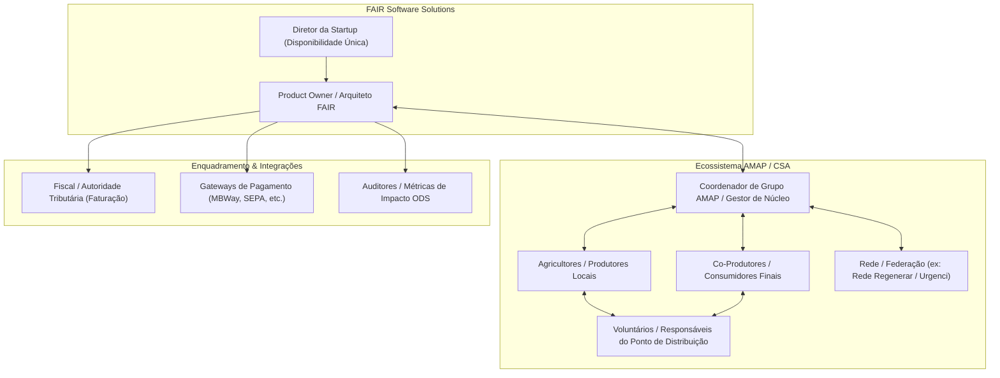
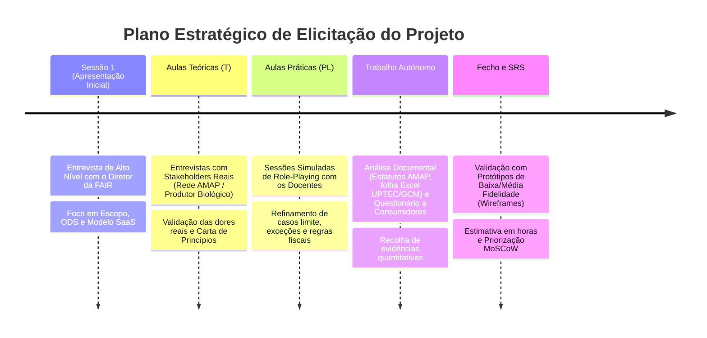

# Guia de Elicitação de Requisitos — Projeto FAIR-AMAP / CSA
**Unidade Curricular:** Engenharia de Requisitos (ENGREQ)  
**Curso:** Mestrado em Engenharia Informática — Sistemas de Informação e Conhecimento (MEI-SIC)  
**Instituição:** Instituto Superior de Engenharia do Porto (ISEP)  
**Ano Letivo:** 2026/2027 | **Trabalho Prático:** TP1 (v1.0)  
**Docentes:** Jorge Santos, Bruno Silva  
**Autor:** Engenheiro de Requisitos Sénior / Analista de Negócio

---

## 1. Contexto e Enquadramento Estratégico

### 1.1. O Desafio FAIR Software Solutions
A **FAIR Software Solutions** é uma startup focada em soluções digitais que fomentem a distribuição e comercialização justa de alimentos, no âmbito da **Agenda 2030 das Nações Unidas** e dos seus 17 Objetivos de Desenvolvimento Sustentável (ODS), com particular incidência em:
* **ODS 2:** Erradicar a Fome e Agricultura Sustentável;
* **ODS 8:** Trabalho Digno e Crescimento Económico;
* **ODS 12:** Produção e Consumo Sustentáveis;
* **ODS 13:** Ação Climática (redução do desperdício e circuitos curtos agroalimentares).

A startup identificou uma oportunidade de mercado no modelo **AMAP** (*Associação pela Manutenção da Agricultura de Proximidade*) e **CSA** (*Community Supported Agriculture*), pretendendo especificar uma plataforma de software integral que apoie todos os processos inerentes a esta dinâmica.

### 1.2. O Modelo AMAP / CSA e as suas Especificidades
Diferente de um comércio eletrónico tradicional (*e-commerce* transacional), o modelo AMAP assenta em:
1. **Relação de Parceria e Co-responsabilidade:** O consumidor é um **Co-Produtor** que partilha os riscos (intempéries, quebras de colheita) e as bênçãos da produção com o agricultor.
2. **Subscrição por Ciclos Sazonais:** O planeamento é trimestral (Primavera, Verão, Outono, Inverno) com pagamento antecipado, garantindo previsibilidade e dignidade económica ao produtor.
3. **Cabaz Agroecológico Fechado:** Não há seleção avulso de legumes; o cabaz semanal reflete a colheita real da época, podendo existir produtos complementares contratados (pão, azeite, fruta, queijo, mel).
4. **Distribuição Solidária Comunitária:** Entregas semanais em Pontos de Partilha/Recolha locais, dinamizados em regime de voluntariado e entreajuda.
5. **Circuitos Curtos e Desperdício Zero:** Eliminação de intermediários e doação ou redistribuição de excedentes.

### 1.3. Restrições do Processo de Elicitação (De acordo com o Enunciado)
* **Diretor da FAIR Software Solutions:** *Disponível exclusivamente na sessão de apresentação inicial do projeto.* Oportunidade única para questões estratégicas, modelo de negócio, visão e restrições globais.
* **Docentes nas Aulas PL:** Irão desempenhar o papel (*role-playing*) de diferentes clientes e stakeholders operacionais (produtores, consumidores, coordenadores).
* **Stakeholders Reais nas Aulas T:** Sessões com intervenientes do terreno e análise documental (ex.: [AMAP Portugal / Rede Regenerar](https://amap.movingcause.org/)).
* **Entregável:** Documento SRS (*Software Requirements Specification*) contendo requisitos funcionais, não-funcionais, interfaces externas, priorização MoSCoW, estimativas em horas e a fundamentação metodológica do processo de engenharia de requisitos.

---

## 2. Mapa Geral de Stakeholders

---

## 3. Guião de Questões Estratégicas para o Diretor da FAIR Software Solutions
> **CRÍTICO:** O Diretor só estará presente na **sessão inicial**. As questões têm de ser focadas no posicionamento estratégico, proposta de valor, limites do sistema (*scope boundaries*), modelo económico e métricas de impacto.

### 3.1. Visão de Produto e Modelo Operacional
1. **Natureza da Solução:** A FAIR pretende desenvolver uma solução **SaaS Multi-tenant** aberta a qualquer grupo AMAP independente em Portugal/Europa, ou um software centralizado e exclusivo gerido pela FAIR para uma rede de produtores afiliados?
2. **Posicionamento de Mercado:** Existem ferramentas abertas ou tradicionais usadas pela comunidade (Google Sheets, Open Food Network, Camaleon, Cagette). Qual é a principal proposta de diferenciação da FAIR para incentivar a migração para a vossa plataforma?
3. **Público-Alvo Primário:** Na primeira fase, o foco prioritário é a captação de agricultores que queiram iniciar uma AMAP, a formalização de grupos informais já existentes, ou atrair o grande público consumidor para o modelo CSA?

### 3.2. Modelo de Negócio, Ética e Sustentabilidade Financeira
4. **Monetização e Espírito AMAP:** O movimento AMAP rejeita a mercantilização pura e comissões predatórias sobre os alimentos. Como pretende a startup rentabilizar o serviço (e.g., subscrição fixa por grupo AMAP paga via quotas, financiamento de impacto social, modelo *freemium*, ou taxa administrativa fixa por co-produtor)?
5. **Orçamento e Roadmap:** Qual é o horizonte temporal esperado para o MVP (*Minimum Viable Product*) e qual o nível de recursos alocado para a fase de desenvolvimento subsequente?

### 3.3. Métricas de Impacto e Agenda 2030 (ODS)
6. **Quantificação de Sustentabilidade:** Como o software deve refletir o compromisso com os ODS da ONU? Espera-se que a plataforma calcule e mostre indicadores aos utilizadores (ex.: km alimentares poupados, emissões de CO₂ evitadas, percentagem de desperdício evitado, remuneração digna por hora de trabalho agrícola)?
7. **Critérios de Sucesso do Projeto (KPIs):** Que métricas, ao final de 6 a 12 meses após entrada em produção, ditarão se este investimento da FAIR foi bem-sucedido?

---

## 4. Guião de Questões para Agricultores / Produtores Locais
> **Objetivo:** Compreender a gestão da produção agrícola, capacidade de resposta, limitações de tempo e literacia tecnológica no campo, e partilha de risco.

### 4.1. Planeamento de Colheita e Gestão de Capacidade
8. **Definição do Ciclo:** Como planeia as culturas para cada trimestre (Primavera, Verão, Outono, Inverno)? Como determina o número máximo de cabazes que a sua terra consegue suportar sem esgotar o solo nem falhar compromissos?
9. **Composição do Cabaz:** Que variedade de produtos disponibiliza habitualmente? Mantém um cabaz hortícola base e permite subscrições complementares independentes (ex.: pão de centeio, queijo de cabra, azeite, fruta, ovos)?
10. **Tamanhos e Formatos:** Pratica apenas um tamanho único de cabaz, ou dispõe de variantes (ex.: Cabaz Familiar, Cabaz Individual/Casal)? As quantidades são medidas por peso (kg), por unidade ou por porções culinárias para uma semana?

### 4.2. Gestão de Riscos, Imprevistos e Transparência
11. **Quebras de Produção:** Quando ocorrem intempéries (geada, granizo, praga de míldio, canícula extrema), como comunica isso à sua comunidade? Prefere que o sistema permita:
    * Notificação imediata com explicação do produtor;
    * Redução proporcional temporária do cabaz de todos os co-produtores;
    * Compensação futura (semana de colheita abundante);
    * Ou substituição por outro produto equivalente produzido na mesma quinta?
12. **Excedentes de Colheita:** Em semanas de colheita abundante (*picos sazonais*), como prefere gerir o excedente? Oferecer no cabaz como bónus solidário, disponibilizar para venda avulso extra aos membros da AMAP, ou doar a instituições sociais locais?

### 4.3. Logística de Colheita, Embalamento e Distribuição
13. **Janela de Colheita:** Com que antecedência em relação ao dia de entrega precisa de ter a lista fechada dos cabazes a preparar? (Ex.: a lista de quem levanta o cabaz na terça-feira tem de estar congelada ao domingo à noite para permitir colher na segunda-feira de manhã?)
14. **Transporte e Recipientes:** Como são transportados e acondicionados os alimentos (caixas plásticas reutilizáveis do produtor, sacos de pano dos próprios consumidores)? O sistema necessita de controlar a tara ou devolução de recipientes e caixas?

### 4.4. Faturação, Obrigações Fiscais e Tecnologia
15. **Simplificação Fiscal:** Como cumpre atualmente os requisitos da Autoridade Tributária (AT)? Emite uma fatura global da entrega ao grupo de entrega, fatura individual rotativa a cada co-produtor, ou necessita de emissão de faturas-recibo individuais automatizadas por via eletrónica?
16. **Contexto de Utilização:** Onde e quando acede mais frequentemente à tecnologia? Precisa de uma aplicação móvel com funcionamento **offline** no campo (para registar colheitas ou verificar entregas sem ligação de dados), ou utiliza um computador em casa/escritório no final do dia?

---

## 5. Guião de Questões para Co-Produtores / Consumidores
> **Objetivo:** Compreender as motivações, a experiência do utilizador, a gestão de ausências/férias, fidelização e a aceitação das regras do modelo AMAP.

### 5.1. Adesão e Processo de Subscrição
17. **Motivação e Barreiras:** O que o levou a procurar a AMAP em vez do supermercado ou mercearia biológica convencional? Quais as maiores dificuldades que sentiu ao aderir (compreender as épocas, encontrar o formulário, forma de pagamento, tempo de espera)?
18. **Duração do Compromisso:** A subscrição trimestral ou anual é vista como confortável, ou prefere opções com maior flexibilidade (ex.: subscrição mensal contínua com renovação automática)?

### 5.2. Personalização vs. Filosofia do Cabaz
19. **Preferências e Restrições:** Sabendo que o modelo AMAP não permite escolher peça a peça os legumes do cabaz (pois depende da natureza), gostaria de poder assinalar **alergias severas** ou intolerâncias graves para que o agricultor possa fazer uma substituição segura?
20. **Mesa de Trocas:** Nos pontos de recolha, é costume existir uma "banca de trocas" (onde se pode deixar um legume que não se aprecia e trocar por outro deixado por outro co-produtor). Considera útil que o sistema digital apoie ou registe esta dinâmica comunitária?

### 5.3. Gestão de Impossibilidades e Ausências (Férias e Imprevistos)
21. **Ausência Semanal:** O que faz quando não pode levantar o cabaz num determinado dia por motivo de trabalho, doença ou férias?
    * Prefere designar um familiar/amigo (com emissão de comprovativo ou código na aplicação)?
    * Prefere doar o cabaz dessa semana a uma família carenciada ou instituição social com um simples clique na app?
    * Ou gostaria de poder suspender até um máximo de *N* semanas por ciclo (avançando a compensação)?
22. **Desistência a Meio do Ciclo:** Sendo o compromisso de sustentar a época, se necessitar mesmo de cancelar a adesão, aceitaria o mecanismo tradicional da AMAP onde o membro indica/transfere a sua vaga para um substituto da lista de espera?

### 5.4. Pagamentos e Notificações
23. **Métodos de Pagamento:** Qual a forma mais conveniente e transparente para si: Transferência Bancária manual com envio de comprovativo, Débito Direto SEPA mensal, ou MBWay / Cartão bancário?
24. **Canais de Comunicação:** Como gostaria de ser lembrado do dia de recolha e avisado do que vem no cabaz da semana (Email, Notificação Push na app, SMS, ou canal Telegram/WhatsApp)? Dá valor a receber receitas adaptadas aos produtos da semana?

---

## 6. Guião de Questões para Coordenadores de Grupo e Gestores de Núcleo
> **Objetivo:** Analisar a carga administrativa, gestão de inscrições, distribuição de funções, relacionamento entre múltiplos agricultores e governança associativa.

### 6.1. Gestão de Membros e Ciclos
25. **Organização das Épocas:** Como é gerido atualmente o processo de transição de ciclo (ex.: abertura de formulários de renovação para membros antigos vs. abertura a novas inscrições)? Quantas horas semanais despende nessa tarefa?
26. **Gestão de Lista de Espera:** Quando a procura excede a capacidade de produção dos agricultores associados, como é feita a priorização na lista de espera (ordem cronológica, proximidade geográfica, disponibilidade para ser voluntário)?

### 6.2. Multi-Produtores e Consolidação de Pedidos
27. **Coordenação de Múltiplos Produtores:** Um grupo AMAP pode ter 4 ou 5 produtores independentes (um hortícola, um padeiro, um apicultor, um fruticultor, um produtor de cogumelos). Como é feita a agregação dos pedidos e a divisão dos montantes pagos pelos membros para cada um deles?
28. **Folhas de Distribuição:** Qual o formato da folha de apoio ao dia de entrega (papel impresso com lista cruzada "Membro x Produtos", folha de cálculo partilhada)? Que erros ou desencontros acontecem com mais frequência no momento da entrega?

### 6.3. Dinâmica de Voluntariado e Turnos no Ponto de Recolha
29. **Escala de Responsáveis:** Sendo a AMAP autogerida, como é feita a rotação de co-produtores que ficam de serviço no ponto de distribuição (montagem das bancas, receção do furgão do agricultor, conferência das entregas, limpeza)?
30. **Registo de Faltas e Penalizações:** Como o grupo lida com situações em que um membro se compromete a fazer um turno de voluntariado e não comparece? O sistema deve ter um mecanismo de agendamento de turnos e lembretes automáticos?

### 6.4. Governança, Quotas e Rede
31. **Quotas de Apoio à Rede:** A AMAP cobra uma quota anual ou de adesão (por exemplo, os 5€ anuais para a Rede Regenerar). Como é cobrada, registada e transferida essa verba?
32. **Assembleias e Decisões:** As assembleias de produtores e consumidores (para aprovação de contas e definição dos preços do ano seguinte) necessitam de suporte na plataforma (votações, partilha de atas e orçamentos)?

---

## 7. Guião de Questões para os Voluntários do Ponto de Distribuição
> **Objetivo:** Otimizar o fluxo físico durante as 2 horas semanais de entrega, minimizando filas, erros e desperdício de tempo.

33. **Check-in no Local:** Como é confirmada a presença do membro no ponto de entrega? O voluntário prefere pesquisar pelo nome numa lista digital, ler um QR Code no telemóvel do co-produtor, ou manter papel e caneta?
34. **Gestão de Sobras / Esquecimentos:** À hora do fecho do ponto (ex.: 19h30 ou 20h00), se restarem cabazes não levantados e sem aviso prévio, qual o procedimento operacional padrão? Ficam guardados num local refrigerado parceiro, ou são imediatamente doados para evitar que se estraguem?
35. **Registo de Incidentes:** Se um produto chegar danificado ou faltar um item na caixa do agricultor, como o voluntário de serviço comunica esse incidente ao produtor e ao coordenador?

---

## 8. Guião de Questões Técnicas, Arquitetura e Requisitos Não-Funcionais
> **Objetivo:** Mapear requisitos de desempenho, segurança, conformidade legal, usabilidade e integração de sistemas para o SRS.

### 8.1. Arquitetura e Integrações Externas
36. **Multi-Tenancy vs. Instância Única:** A arquitetura do sistema deve isolar os dados de cada AMAP em bases de dados independentes (lógica multi-tenant estrita), ou os utilizadores podem ter uma conta global que lhes permita participar em mais do que um grupo AMAP?
37. **Integração com Autoridade Tributária (AT):** O sistema deve comunicar diretamente via webservice com um software de faturação certificado (ou com a API da AT através do envio de SAF-T PT / comunicação de faturas em tempo real), ou basta exportar ficheiros contabilísticos padronizados?
38. **Gateways de Pagamento:** Existe necessidade de integração direta com APIs de pagamento portuguesas (SIBS / Easypay / Ifthenpay para referências Multibanco e MBWay, ou Stripe / GoCardless para Débito Direto SEPA)?

### 8.2. Usabilidade, Acessibilidade e Condições de Operação
39. **PWA / Modo Offline:** Sendo os pontos de recolha frequentemente instalados em locais sem rede Wi-Fi estável (mercados municipais, garagens, jardins comunitários, sedes desportivas) e os agricultores trabalhando em zonas agrícolas com cobertura móvel fraca:
    * É obrigatório que o sistema funcione como Progressive Web App (PWA) ou app nativa com armazenamento local (IndexedDB / SQLite) e sincronização bidirecional em segundo plano?
40. **Acessibilidade para Público Sénior:** Muitos pequenos agricultores e alguns co-produtores têm literacia digital reduzida ou utilizam ecrãs em ambientes de alta luminosidade exterior. Que requisitos de contraste (WCAG 2.1 AA), tamanho de tipografia e simplicidade visual de fluxos devem ser garantidos?

### 8.3. Segurança, Privacidade e Conformidade (RGPD)
41. **Privacidade de Dados dos Co-Produtores:** Quem tem acesso aos dados pessoais de quem? O agricultor tem acesso ao telefone e morada do membro, ou apenas ao nome e preferências de entrega? Os voluntários do ponto têm acesso aos dados de pagamento?
42. **Consentimentos e Direito ao Esquecimento:** Como devem ser geridos os registos históricos de transações agrícolas face ao dever de conservação fiscal (10 anos segundo a lei portuguesa) versus o pedido de eliminação de dados pessoais ao abrigo do RGPD?

### 8.4. Desempenho e Disponibilidade
43. **Picos de Utilização Concorrente:** Os picos de tráfego ocorrem em dois momentos muito definidos: na abertura das inscrições do trimestre e durante as 2 horas semanais da entrega. Qual o tempo máximo de resposta admissível numa operação de check-in (ex.: < 1 segundo para não gerar filas)?
44. **Disponibilidade e Tolerância a Falhas:** Qual o SLA de disponibilidade exigido durante a janela crítica de distribuição semanal?

---

## 9. Matriz de Mapeamento: Stakeholder vs. Processos AMAP / CSA

Esta matriz permite à equipa de analistas do ISEP garantir a rastreabilidade completa entre as sessões de elicitação e os capítulos do SRS:

| Processo AMAP / CSA | Diretor FAIR | Produtor | Co-Produtor | Coordenador | Voluntário Ponto | Técnico / Arq. |
| :--- | :---: | :---: | :---: | :---: | :---: | :---: |
| **P1: Gestão de Visão, ODS e Modelo** | **Principal** | Secundário | Secundário | Informativo | — | **Principal** |
| **P2: Planeamento de Época e Capacidade** | Secundário | **Principal** | Informativo | **Principal** | — | Suporte |
| **P3: Catálogo de Produtos e Cabazes** | — | **Principal** | Requisitante | Suporte | — | Suporte |
| **P4: Subscrição e Gestão de Contratos** | — | Validador | **Principal** | **Principal** | — | Suporte |
| **P5: Pagamentos, Quotas e Faturação** | Secundário | **Principal** | **Principal** | **Principal** | — | **Principal** |
| **P6: Gestão de Ausências e Doações** | Informativo | Impactado | **Principal** | Supervisor | Operacional | Suporte |
| **P7: Logística e Check-in no Ponto** | — | Fornecedor | Beneficiário | Supervisor | **Principal** | **Principal** |
| **P8: Gestão de Voluntariado e Escalas** | — | — | Participante | **Principal** | Operador | Suporte |
| **P9: Gestão de Riscos e Intempéries** | Informativo | **Principal** | Coparticipante | Mediador | — | Suporte |
| **P10: Métricas ODS e Comunidade** | **Principal** | Fornecedor | Consumidor | Fornecedor | — | **Principal** |

---

## 10. Estratégia de Elicitação Recomendada para o Trabalho Prático (ISEP)

Para obter a nota máxima nos critérios de avaliação (1 - Especificar e analisar requisitos; 2 - Trabalho em equipa, planeamento, evidências e comunicação):

### Técnicas Recomendadas e Registo de Evidências:
1. **Entrevista Semiestruturada (com o Diretor da FAIR):**
   * *Ação:* Usar o guião da **Secção 3**. Gravar áudio (com autorização) ou manter duas pessoas do grupo dedicadas a atas detalhadas.
   * *Evidência para o SRS:* Ata de reunião assinada, mapa mental de visão estratégica do produto.
2. **Análise Documental:**
   * *Ação:* Estudar a Carta de Princípios da AMAP (amap.movingcause.org), os formulários Google Forms utilizados pela AMAP Porto (UPTEC) e as folhas de distribuição semanal.
   * *Evidência para o SRS:* Matriz de desconstrução de formulários atuais para entidades de dados.
3. **Questionário / Survey a Consumidores Biológicos:**
   * *Ação:* Lançar um inquérito curto (Google Forms / MS Forms) aos estudantes e colaboradores do ISEP sobre hábitos de consumo de legumes biológicos e apetência pelo modelo de cabaz fechado.
   * *Evidência para o SRS:* Gráficos estatísticos e conclusão sobre métodos de pagamento preferidos e flexibilidade de ausências.
4. **Sessões de Role-Playing (PL com Docentes):**
   * *Ação:* Tratar os docentes formalmente na persona de agricultor ou gestor de ponto. Colocar perguntas situacionais ("O que acontece se...").
   * *Evidência para o SRS:* Histórico de esclarecimentos e decisões de projeto (*Decision Log*).
5. **Prototipagem Rápida e Mockups:**
   * *Ação:* Desenhar wireframes dos ecrãs de "Check-in do Ponto de Entrega" e "Composição do Cabaz Semanal".
   * *Evidência para o SRS:* Validação visual com os utilizadores, reduzindo ambiguidade nos requisitos funcionais.
